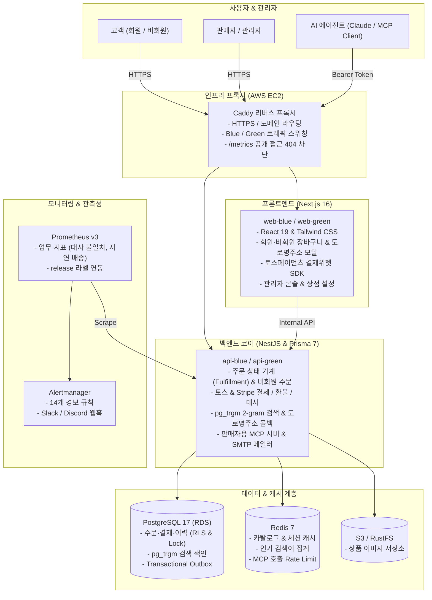
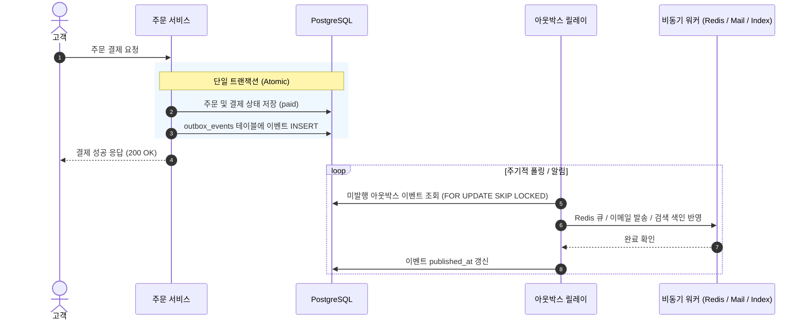

<p align="center">
  <h1 align="center">node-order</h1>
  <p align="center"><b>1인 판매자를 위한 풀스택 이커머스 & AI 운영 코어 시스템</b></p>
  <p align="center">
    NestJS · Next.js 16 (App Router) · Prisma 7 · PostgreSQL 17 · Redis 7 · Toss Payments · MCP · Prometheus · AWS<br>
    단위 174 · 하네스 가드 70 · API E2E 247 · 웹 E2E 57 통과 · Blue/Green 무중단 배포
  </p>
</p>

---

## 📌 한눈에 보기

단순한 CRUD 쇼핑몰을 넘어, **개인 판매자 한 명이 상품 등록부터 검색, 회원·비회원 판매, 결제, 배송 이행, 반품·환불, PG 일일 대사, 그리고 AI 비서(MCP) 연동까지 혼자 운영할 수 있는 프로덕션 시스템**입니다.

- **동시성 & 정합성 우선**: 인기 상품에 결제가 몰려도 재고 초과 판매나 데드락이 발생하지 않도록 비관적 락과 트랜잭셔널 아웃박스를 설계했습니다.
- **회원·비회원 주문 및 도로명주소 검색**: 일반 회원가입 및 프로필 기본 배송지 자동 연동뿐 아니라, 비회원 결제와 `주문번호 + 비회원 비밀번호` 기반 주문 조회(`/guest/orders`), 행안부 도로명주소 API 및 내장 주소 사전 폴백을 지원합니다.
- **국내 PG 결제 및 웹훅 무결성**: 토스페이먼츠 결제위젯을 연동하고, 웹훅 수신 시 PG 실조회 재검증과 일일 대사(Reconciliation) 배치를 수행합니다.
- **1인 운영에 최적화된 검색 & AI 연동**: 무거운 외장 검색엔진 대신 PostgreSQL `pg_trgm` 2-gram 색인으로 오타 보정 검색을 구현하고, Model Context Protocol(MCP) 서버를 구축해 Claude Code 등 AI 에이전트가 상점 주문·재고를 조회·처리할 수 있게 했습니다.
- **관측성과 비용 0원 무중단 배포**: Sentry 에러 수집 시 개인정보를 마스킹하고, Prometheus 업무 지표와 14개 경보 규칙 및 런북을 갖추었으며, 외부 유료 API 키가 없어도 내장 폴백(Fallback)으로 동작합니다.

---

## 🏛️ 시스템 아키텍처



---

## 📦 주요 기능

### 1. 고객 쇼핑몰 (`order-console-next`)
- **회원·비회원 주문**: 회원가입(`/signup`), 내 정보 및 기본 배송지 관리(`/me/profile`), 비회원 결제 및 `주문번호 + 비밀번호` 기반 비회원 주문·배송 조회(`/guest/orders`)
- **도로명주소 검색 모달**: 행안부 도로명주소 API 연동 및 미설정 시 내장 주소 사전 폴백
- **실시간 상품 검색**: 디바운스 자동완성, 오타 보정 검색 결과 페이지, 인기 검색어 순위 노출
- **장바구니 & 결제**: 5만 원 이상 무료 배송 자동 계산, 토스페이먼츠 결제위젯 연동
- **주문 상태 타임라인 & 반품**: `결제완료 ➔ 배송준비 ➔ 배송중 ➔ 배송완료 ➔ 구매확정` 추적, 배송 완료 후 7일 이내 반품 신청 및 왕복 배송비 공제 환불

### 2. 관리자 콘솔 (`/admin`)
- **실시간 대시보드**: 일일 순매출, 미처리 주문, 재고 부족 알림, 미해결 대사 불일치 현황 집계
- **주문 이행(Fulfillment) 관리**: 회원·비회원 주문 구분 배지, 운송장 번호 등록 및 발송 처리, 반품 접수 승인/거절
- **상점 정보 & 약관 버전 관리**: 상호/사업자번호 설정(`If-Match` 낙관적 락), 고객용 법적 고지문 자동 반영
- **PG 대사(Reconciliation) 모니터링**: 토스/Stripe 거래 내역과 DB 결제 행 비교, 불일치 내역 메모 및 수동 확정
- **MCP API 토큰 관리**: AI 에이전트 연결용 개인 접근 토큰(`nop_...`) 발급, 권한 범위 설정 및 폐기

### 3. 판매자용 AI MCP 서버 (`POST /mcp`)
- Claude Code 등 MCP 클라이언트를 상점에 연결하여 터미널/대화창에서 상점 운영 업무 수행
- **지원 도구 (11개)**: `list_pending_work`, `search_orders`, `register_shipment`, `approve_return`, `adjust_stock` 등
- **보안 & 감사**: 토큰 인증, untrusted 필드 분리, 프롬프트 인젝션 방어, 모든 호출의 `mcp_audit_log` 감사 기록

---

## 🛠️ 기술적으로 고민한 것 (Engineering Deep Dives)

### 1. 재고 초과 판매와 데드락 없는 동시성 제어

- **비관적 락 선택**: 인기 상품에 결제가 몰리는 특성상 `SELECT ... FOR UPDATE` 비관적 락을 적용하여 충돌을 대기로 직렬화했습니다.
- **다중 품목 데드락(Deadlock) 해결**: 장바구니에서 여러 품목을 서로 다른 순서로 결제할 때 교착 상태가 발생하지 않도록 모든 트랜잭션에서 **상품 ID 순서대로 오름차순 정렬하여 잠금을 획득**합니다.
- **결제 멱등성 보장**: 네트워크 타임아웃으로 인한 중복 결제를 막기 위해 `Idempotency-Key`를 주문 트랜잭션과 원자적으로 기록합니다.

### 2. 분산 데이터 불일치를 막는 트랜잭셔널 아웃박스 (Transactional Outbox)



- 주문 상태 변경과 `outbox_events` 테이블 저장을 **동일한 RDB 트랜잭션**으로 묶고, 릴레이 워커가 `FOR UPDATE SKIP LOCKED`로 처리해 적어도 한 번(At-least-once) 발행을 보장합니다.

### 3. 회원·비회원 주문 식별과 도로명주소 폴백

- **비회원 비밀번호 검증**: 비회원 결제 시 입력받은 비밀번호를 해시로 저장하고, `/guest/orders` 조회·취소·반품 시 주문번호와 비밀번호 일치를 검증합니다.
- **배송비 스냅샷 고정**: 상점 기본 배송비 정책이 바뀌더라도 과거 주문의 정산이 흔들리지 않도록 주문 시점의 배송비를 주문 행에 스냅샷으로 기록합니다.
- **도로명주소 2중 폴백**: 행안부 도로명주소 API 키 미설정이나 네트워크 타임아웃 시 내장 주소 사전으로 즉시 전환합니다.

### 4. PostgreSQL `pg_trgm` 검색 · PG 일일 대사 · AI MCP · 관측성

- **2-gram Trigram 색인**: PostgreSQL `pg_trgm` 확장과 GIN 인덱스로 한글 2글자 이상 부분 일치 및 오타 보정(`similarity > 0.3`)을 처리합니다.
- **PG 웹훅 재검증 & 04:00 KST 대사 배치**: 웹훅 수신 시 토스/Stripe API를 역조회하고, 매일 새벽 전날 결제 내역과 DB 행을 전수 대조합니다.
- **MCP 서버 & 관측성**: 11개 도구를 제공하는 Streamable HTTP MCP 서버, Sentry `scrubEvent` 개인정보 마스킹 및 Prometheus 14개 경보 규칙을 운영합니다.

---

## 🚀 로컬 실행 방법 (Quick Start)

### 1. 개발 인프라 기동
```sh
npm ci
docker compose up -d
```

### 2. 환경변수 준비
```sh
cp order-api-nest/.env.example order-api-nest/.env
cp order-console-next/.env.example order-console-next/.env.local
```

### 3. DB 마이그레이션 및 시드 데이터 적재
```sh
cd order-api-nest
npx prisma migrate dev
npm run seed
cd ..
```

### 4. 개발 서버 실행
```sh
# 터미널 1: NestJS API (포트 4000)
npm run dev:api

# 터미널 2: Next.js 콘솔 (포트 3000)
npm run dev:web
```

브라우저에서 `http://localhost:3000`으로 접속하여 데모 계정(`kim`/`1234`)으로 로그인할 수 있습니다.

---

## 🧪 테스트 및 하네스 검증

```sh
# 1. 빠른 검사 (Prisma + Lint + Typecheck + 단위 테스트 174개 + 하네스 가드 70개)
npm run verify:fast

# 2. 프로덕션 모니터링 규칙 검사 (Prometheus 14개 경보 + Alertmanager 렌더러 + 메모리 상한)
npm run test:rules

# 3. 전체 검증 (Fast + 백엔드 e2e 247개 + 프론트 Playwright e2e 57개 + 결제 시뮬레이터 대역)
npm run verify
```

---

## 🚢 무중단 배포 (AWS Blue/Green)

- **릴리스 흐름**: `release.sh up <새_태그>` (대기 슬롯 기동 및 마이그레이션) ➔ Playwright 스모크 테스트 ➔ `release.sh switch` (Caddy 리버스 프록시 트래픽 전환)
- **비용 0원 운영**: 외부 유료 키(`LLM_API_KEY`, `STRIPE_SECRET_KEY`, `SENTRY_DSN`, `JUSO_API_KEY`)가 비어 있어도 시스템이 안전하게 Fallback 모드로 기동됩니다.
- **서버 환경변수 동기화**:
  ```sh
  TOSS_CLIENT_KEY=test_ck_... TOSS_SECRET_KEY=test_sk_... bash deploy/aws/60-server-env.sh
  ```
