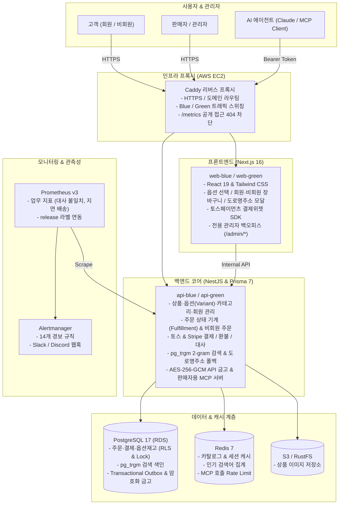
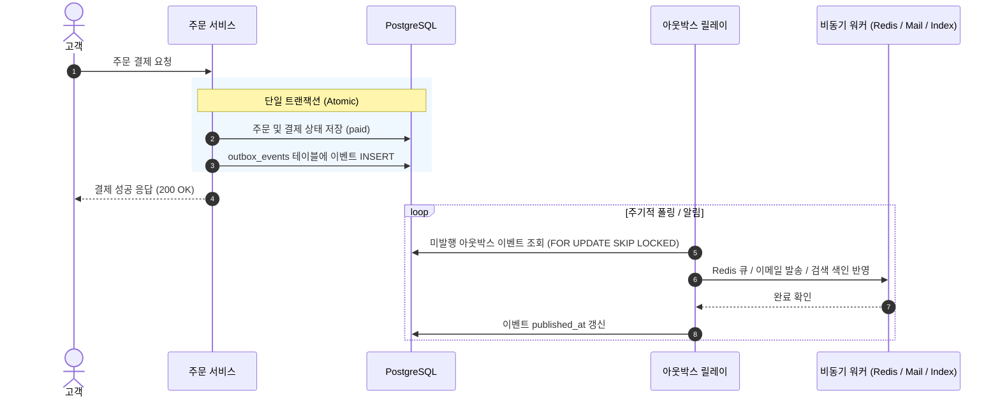

<p align="center">
  <h1 align="center">node-order</h1>
  <p align="center"><b>1인 판매자를 위한 풀스택 이커머스 & AI 운영 코어 시스템</b></p>
  <p align="center">
    NestJS · Next.js 16 (App Router) · Prisma 7 · PostgreSQL 17 · Redis 7 · Toss Payments · MCP · Prometheus · AWS<br>
    단위 174 · 하네스 가드 70 · API E2E 252 · 웹 E2E 62 통과 · Blue/Green 무중단 배포
  </p>
</p>

---

## 📌 한눈에 보기

단순한 CRUD 쇼핑몰을 넘어, **개인 판매자 한 명이 상품·옵션 등록부터 검색, 회원·비회원 판매, 결제, 배송 이행, 반품·환불, PG 일일 대사, 암호화 API 금고, 그리고 AI 비서(MCP) 연동까지 혼자 운영할 수 있는 프로덕션 시스템**입니다.

- **동시성 & 옵션 재고 정합성**: 인기 상품이나 다차원 옵션(`ProductVariant`)에 결제가 몰려도 재고 초과 판매나 데드락이 발생하지 않도록 비관적 락(`SELECT ... FOR UPDATE`)과 트랜잭셔널 아웃박스를 설계했습니다.
- **어드민 백오피스 분리 & AES-256-GCM 금고**: 스토어프론트와 `/admin/*` 백오피스 레이아웃을 분리하여 상품·옵션·카테고리·회원 관리 워크스페이스를 제공하고, 재배포 없이 외부 API 키를 등록·교체하는 암호화 금고와 긴급 제어 스위치를 갖추었습니다.
- **회원·비회원 주문 및 도로명주소 검색**: 일반 회원가입 및 기본 배송지 자동 연동, 비회원 결제 및 주문 조회(`/guest/orders`), 행안부 도로명주소 API 및 내장 주소 사전 폴백을 지원합니다.
- **국내 PG 결제 · 검색 · AI MCP 연동**: 토스페이먼츠 결제위젯 및 일일 전수 대사, PostgreSQL `pg_trgm` 2-gram 오타 보정 검색, 11개 비즈니스 도구를 갖춘 MCP 서버를 제공합니다.
- **관측성과 비용 0원 무중단 배포**: Sentry 에러 수집 시 개인정보를 마스킹하고, Prometheus 업무 지표와 14개 경보 규칙 및 런북을 갖추었으며, 외부 유료 API 키가 없어도 내장 폴백(Fallback)으로 동작합니다.

---

## 🏛️ 시스템 아키텍처



---

## 📦 주요 기능

### 1. 고객 쇼핑몰 (`order-console-next`)
- **다차원 상품 옵션(SKU) 선택**: 색상·사이즈 조합별 추가금 및 실시간 재고 확인, 2단계 계층 카테고리 필터 바
- **회원·비회원 주문 & 도로명주소 검색**: 회원가입·내 정보 관리, 비회원 결제·조회(`/guest/orders`), 도로명주소 검색 폴백 모달
- **실시간 상품 검색 & 결제**: 디바운스 자동완성, `pg_trgm` 오타 보정 검색, 토스페이먼츠 결제위젯 연동, 배송 완료 후 7일 이내 반품 신청

### 2. 관리자 백오피스 (`/admin/*`)
- **스토어프론트와 백오피스 레이아웃 분리**: 좌측 사이드바 워크스페이스(`/admin/*`) 및 상점 화면 우측 하단 관리자 플로팅 배지
- **상품·옵션 & 카테고리 & 회원 관리**: 다중 옵션(`ProductVariant`) 빌더를 포함한 상품 등록·수정·삭제, 2단계 카테고리 트리 관리(`/admin/categories`), 회원 정지·해제 및 개인정보 익명화(`/admin/users`)
- **시스템·API 금고 및 런타임 제어 (`/admin/system`)**: 외부 API 비밀키 AES-256-GCM 암호화 저장 및 마스킹 조회, 유료 API 일괄 차단(`pause_paid_apis`) 및 상점 점검 503 모드(`maintenance_mode`) 토글
- **주문 이행 & PG 대사**: 운송장 등록 및 반품 승인/거절, 토스/Stripe 거래 내역과 DB 결제 행 일일 대사

### 3. 판매자용 AI MCP 서버 (`POST /mcp`)
- Claude Code 등 MCP 클라이언트를 상점에 연결하여 터미널/대화창에서 상점 운영 업무 수행
- **지원 도구 (11개)**: `list_pending_work`, `search_orders`, `register_shipment`, `approve_return`, `adjust_stock` 등
- **보안 & 감사**: 토큰 인증, untrusted 필드 분리, 프롬프트 인젝션 방어, 모든 호출의 `mcp_audit_log` 감사 기록

---

## 🛠️ 기술적으로 고민한 것 (Engineering Deep Dives)

### 1. 다차원 옵션(`ProductVariant`) 재고 비관적 잠금과 상위 재고 동기화

- **옵션별 비관적 락**: 옵션 상품 결제 시 `ProductVariant` 행을 ID 오름차순 `SELECT ... FOR UPDATE`로 잠그고 재고를 차감합니다.
- **상위 재고 동기화**: 단일 트랜잭션 내에서 옵션 재고 차감·복구 시 상위 `Product.stock` 합산 재고를 함께 갱신하여 목록 화면과 상세 옵션 재고 간 불일치를 방지합니다.
- **결제 멱등성 보장**: `Idempotency-Key`를 주문 트랜잭션과 원자적으로 기록하여 중복 결제를 막습니다.

### 2. 분산 데이터 불일치를 막는 트랜잭셔널 아웃박스 (Transactional Outbox)



- 주문 상태 변경과 `outbox_events` 테이블 저장을 **동일한 RDB 트랜잭션**으로 묶고, 릴레이 워커가 `FOR UPDATE SKIP LOCKED`로 처리해 적어도 한 번(At-least-once) 발행을 보장합니다.

### 3. AES-256-GCM 런타임 금고와 긴급 제어 스위치

- Node.js `crypto` 모듈의 `scryptSync`와 `aes-256-gcm`(12바이트 IV + 16바이트 Auth Tag)을 사용해 비밀키를 DB에 암호화 보관하며, API 응답에는 마스킹 프리뷰만 노출합니다.
- `maintenance_mode` 활성화 시 결제 엔드포인트가 `503 Service Unavailable`을 반환하여 점검 중 신규 주문을 차단합니다.

### 4. PostgreSQL `pg_trgm` 검색 · PG 일일 대사 · AI MCP · 관측성

- PostgreSQL 2-gram GIN 인덱스, 매일 04:00 KST PG 전수 대사 배치, 11개 도구를 제공하는 Streamable HTTP MCP 서버, Sentry `scrubEvent` 개인정보 마스킹 및 Prometheus 14개 경보 규칙을 운영합니다.

---

## 🚀 로컬 실행 방법 (Quick Start)

### 1. 개발 인프라 기동
```sh
npm ci
docker compose up -d
```

### 2. 환경변수 준비
```sh
cp order-api-nest/.env.example order-api-nest/.env
cp order-console-next/.env.example order-console-next/.env.local
```

### 3. DB 마이그레이션 및 시드 데이터 적재
```sh
cd order-api-nest
npx prisma migrate dev
npm run seed
cd ..
```

### 4. 개발 서버 실행
```sh
# 터미널 1: NestJS API (포트 4000)
npm run dev:api

# 터미널 2: Next.js 콘솔 (포트 3000)
npm run dev:web
```

브라우저에서 `http://localhost:3000`으로 접속하여 데모 계정(`kim`/`1234`)으로 로그인할 수 있습니다.

---

## 🧪 테스트 및 하네스 검증

```sh
# 1. 빠른 검사 (Prisma + Lint + Typecheck + 단위 테스트 174개 + 하네스 가드 70개)
npm run verify:fast

# 2. 프로덕션 모니터링 규칙 검사 (Prometheus 14개 경보 + Alertmanager 렌더러 + 메모리 상한)
npm run test:rules

# 3. 전체 검증 (Fast + 백엔드 e2e 252개 + 프론트 Playwright e2e 62개 + 결제 시뮬레이터 대역)
npm run verify
```

---

## 🚢 무중단 배포 (AWS Blue/Green)

- **릴리스 흐름**: `release.sh up <새_태그>` (대기 슬롯 기동 및 마이그레이션) ➔ Playwright 스모크 테스트 ➔ `release.sh switch` (Caddy 리버스 프록시 트래픽 전환)
- **비용 0원 운영**: 외부 유료 키(`LLM_API_KEY`, `STRIPE_SECRET_KEY`, `SENTRY_DSN`, `JUSO_API_KEY`)가 비어 있어도 시스템이 안전하게 Fallback 모드로 기동됩니다.
- **서버 환경변수 동기화**:
  ```sh
  TOSS_CLIENT_KEY=test_ck_... TOSS_SECRET_KEY=test_sk_... bash deploy/aws/60-server-env.sh
  ```
