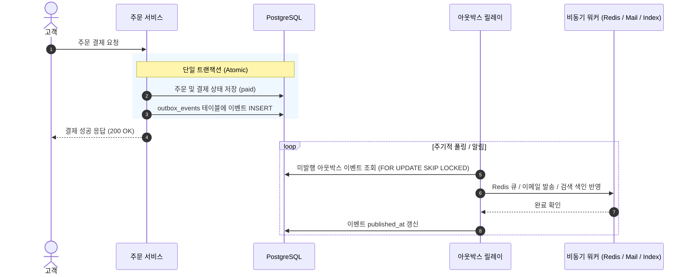

<p align="center">
  <h1 align="center">node-order</h1>
  <p align="center"><b>1인 판매자를 위한 고신뢰 풀스택 이커머스 & AI 운영 코어 시스템</b></p>
  <p align="center">
    NestJS · Next.js 16 (App Router) · Prisma 7 · PostgreSQL 17 · Redis 7 · Toss Payments · MCP · Prometheus · AWS<br>
    단위/통합/하네스 테스트 230+개 통과 · Blue/Green 무중단 배포
  </p>
</p>

---

## 📌 한눈에 보기

단순한 CRUD 쇼핑몰을 넘어, **개인 판매자 한 명이 상품 등록부터 검색, 판매, 결제, 배송 이행, 반품·환불, PG 일일 대사, 그리고 AI 비서(MCP) 연동까지 혼자 온전히 운영할 수 있는 실전 프로덕션 시스템**입니다.

- **동시성 & 정합성 우선**: 인기 상품에 결제가 몰려도 재고 초과 판매나 데드락이 발생하지 않도록 비관적 락과 트랜잭셔널 아웃박스를 설계했습니다.
- **국내 PG 결제 및 웹훅 무결성**: 토스페이먼츠 최신 결제위젯을 연동하고, 웹훅 수신 시 PG 실조회 재검증과 일일 대사(Reconciliation) 배치를 통해 단 1원의 오차도 추적합니다.
- **1인 운영에 최적화된 검색 & AI 연동**: 무거운 JVM 기반 검색엔진 대신 PostgreSQL `pg_trgm` 2-gram 색인으로 오타 보정 검색을 구현하고, Model Context Protocol(MCP) 서버를 구축해 Claude Code 등 AI 에이전트가 상점 주문·재고를 조회·처리할 수 있게 했습니다.
- **철저한 관측성과 무중단 배포**: Sentry 에러 수집 시 개인정보를 철저히 마스킹하고, Prometheus 업무 지표와 14개 경보 규칙 및 런북(Runbook)을 갖추었으며, AWS EC2에서 Blue/Green 무중단 전환을 지원합니다.
- **비용 0원(무료) 운영 가능**: 모든 외부 유료 서비스(LLM, 유료 메일러, 유료 PG)는 키가 없어도 핵심 도메인이 멈추지 않는 방어적 기본값(Fallback/Null Object)으로 설계되어 비용 없이 배포·운영할 수 있습니다.

---

## 🏛️ 시스템 아키텍처


---

## 📦 주요 기능

### 1. 고객 쇼핑몰 (`order-console-next`)
- **실시간 상품 검색**: 디바운스 자동완성, 오타 보정 검색 결과 페이지, 인기 검색어 순위 노출
- **장바구니 & 배송 정책**: 배송지 입력 폼 검증, 5만 원 이상 무료 배송 / 미만 3,000원 자동 계산
- **토스페이먼츠 결제위젯**: 최신 토스 SDK 기반 결제창 연동, 승인 실패 시 복구 가이드 제공
- **주문 상태 타임라인**: `결제완료 ➔ 배송준비 ➔ 배송중 ➔ 배송완료 ➔ 구매확정` 시각적 트래킹
- **배송 추적 & 반품 신청**: 송장번호 링크 연동, 배송 완료 후 7일 이내 반품 신청 및 왕복 배송비 공제 환불

### 2. 관리자 콘솔 (`/admin`)
- **실시간 대시보드**: 일일 순매출, 미처리 주문, 재고 부족 알림, 미해결 대사 불일치 현황 집계
- **주문 이행(Fulfillment) 관리**: 주문 접수, 운송장 번호 등록 및 발송 처리, 반품 접수 승인/거절
- **상점 정보 & 약관 버전 관리**: 상호/사업자번호 설정(`If-Match` 낙관적 락), 고객용 법적 고지문 자동 반영
- **PG 대사(Reconciliation) 모니터링**: 토스/Stripe 거래 내역과 DB 결제 행 비교, 불일치 내역 메모 및 수동 확정
- **MCP API 토큰 관리**: AI 에이전트 연결용 개인 접근 토큰(`nop_...`) 발급, 권한 범위 설정 및 즉시 폐기

### 3. 판매자용 AI MCP 서버 (`POST /mcp`)
- Claude Code 등 MCP 클라이언트를 상점에 연결하여 터미널/대화창에서 상점 운영 업무 수행
- **지원 도구 (11개)**: `list_pending_work`, `search_orders`, `register_shipment`, `approve_return`, `adjust_stock` 등
- **보안 & 감사**: 토큰 인증, untrusted 필드 분리, 프롬프트 인젝션 방어, 모든 호출의 `mcp_audit_log` 감사 기록
- **상품 설명 초안 스트리밍**: 상품 속성(카테고리, 가격, 키워드) 기반 실시간 AI 설명문 자동 생성

---

## 🛠️ 기술적으로 고민한 것 (Engineering Deep Dives)

### 1. 재고 초과 판매와 데드락 없는 동시성 제어

동시에 다수의 고객이 한정 수량 상품을 결제할 때 데이터 정합성을 보장하는 것이 최우선 과제였습니다.

- **비관적 락 선택**: 낙관적 락(Optimistic Lock)은 충돌 시 재시도 비용이 크고, `SERIALIZABLE` 격리 수준은 롤백 빈도가 높았습니다. 인기 상품에 결제가 몰리는 e-커머스 특성상 `SELECT ... FOR UPDATE` 비관적 락을 적용하여 충돌을 대기로 직렬화했습니다.
- **다중 품목 데드락(Deadlock) 해결**: 장바구니에서 상품 A, B를 서로 다른 순서로 결제할 때 상호 잠금 대기로 500 에러가 발생하는 문제를 방지하기 위해, 모든 트랜잭션에서 **상품 ID 순서대로 오름차순 정렬하여 잠금을 획득**하도록 강제했습니다.
- **결제 멱등성 보장**: 네트워크 타임아웃으로 인한 중복 결제를 막기 위해 `Idempotency-Key`를 주문 트랜잭션과 원자적으로 기록하여 동일 키 요청 시 이전 결과를 안전하게 반환합니다.

### 2. 분산 데이터 불일치를 막는 트랜잭셔널 아웃박스 (Transactional Outbox)

주문 결제가 DB에 커밋되었는데 알림 메일 발송이나 검색 색인 갱신이 실패하거나, 반대로 외부 발송은 성공했는데 DB 트랜잭션이 롤백되는 2-Phase Commit 문제를 해결했습니다.



- 주문 상태 변경과 `outbox_events` 테이블 저장을 **동일한 RDB 트랜잭션**으로 묶었습니다.
- 백그라운드 릴레이 워커가 `FOR UPDATE SKIP LOCKED`로 이벤트를 가져와 처리한 후 완료 표시를 남기므로, 서버가 갑자기 죽더라도 재기동 후 누락 없이 적어도 한 번(At-least-once) 발행을 보장합니다.

### 3. PostgreSQL `pg_trgm` 기반 오타 보정 검색 엔진

상품 수가 수천~수만 건인 1인 상점에서 수 GB 메모리를 소모하는 별도 Elasticsearch 클러스터를 운영하는 것은 오버엔지니어링이자 큰 비용 부담이었습니다.

- **2-gram Trigram 색인**: PostgreSQL의 `pg_trgm` 확장 모듈과 GIN 인덱스를 적용하여 한글 2글자 이상 부분 일치 검색을 밀리초(ms) 단위로 처리합니다.
- **오타 보정 알고리즘**: 검색 결과가 0건일 경우 유사도 임계값(`similarity > 0.3`)을 적용해 오타가 섞인 검색어에서도 연관 상품을 자동으로 추천합니다.
- **Redis 기반 실시간 인기 검색어**: 검색 쿼리를 비동기로 Redis ZSET에 카운팅하고, IP 스팸 필터링(동일 IP 중복 방지)을 거쳐 상위 인기 검색어를 실시간 서빙합니다.

### 4. PG 결제 무결성 검증 및 일일 대사(Reconciliation)

결제 시스템은 브라우저 변조와 PG사 비동기 장애에 완벽히 대응해야 합니다.

- **클라이언트 결제 위변조 차단**: 프론트엔드가 보낸 결제 금액을 믿지 않고, 서버에 저장된 원본 주문 금액 + 계산된 배송비 합계를 토스 결제 승인 API 호출 직전에 교차 검증합니다.
- **웹훅 실조회 재검증**: 웹훅 요청은 위조 가능성이 있으므로, 웹훅 수신 시 상태를 즉시 바꾸지 않고 토스/Stripe API를 직접 호출(조회)하여 PG사 원본 데이터의 일치 여부를 확인한 후 상태를 전이합니다.
- **정기 대사 배치 (04:00 KST)**: 매일 새벽 스케줄러가 전날 발생한 모든 PG사 결제 내역과 DB 행을 전수 대조합니다. 금액 불일치(`amount_mismatch`), DB 누락(`missing_in_db`) 등을 감지하여 관리자 화면에 경보를 띄우고 수동 해결 메모를 남길 수 있게 했습니다.

### 5. 판매자용 AI MCP(Model Context Protocol) 서버

AI 에이전트(Claude 등)가 실제 비즈니스 작업을 안전하게 대행할 수 있는 인터페이스를 구축했습니다.

- **공식 SDK 기반 Streamable HTTP**: NestJS 라우트 안에 `POST /mcp` 엔드포인트를 열고 11개의 비즈니스 도구를 선언했습니다.
- **권한 범위 및 감사 로그**: Bearer 토큰 인증(`read`, `write`, `pii`)을 적용하고, 쓰기 도구 호출 시 실행 전/후 감사 로그(`mcp_audit_log`)를 강제했습니다.
- **프롬프트 주입(Prompt Injection) 방어**: LLM이 데이터를 지시어로 오인하지 않도록 고객 입력 데이터(이름, 주소, 배송 메모)에 untrusted 태그를 감싸고 HTML 특수문자를 엄격히 이스케이프했습니다.

### 6. 관측성(Observability)과 개인정보 마스킹

장애 발생 시 빠른 원인 규명과 개인정보 보호를 동시에 달성했습니다.

- **개인정보 자동 마스킹 (`scrubEvent`)**: Sentry로 오류 이벤트를 전송하기 전 `beforeSend` 훅에서 이름, 전화번호, 주소, Authorization 헤더, 쿠키, 결제 비밀키를 정규식 및 키 목록 기반으로 철저히 지웁니다.
- **Prometheus 비즈니스 게이지 지표**: 단순 CPU/메모리 지표 외에 `reconciliation_open_issues`(미해결 대사 건수), `search_index_lag_seconds`(색인 지연 시간), `fulfillment_overdue_orders`(지연 배송 건수) 등 비즈니스 건강 상태를 지표화했습니다.
- **14개 경보 규칙과 런북(Runbook)**: 경보가 울렸을 때 당황하지 않고 즉각 조치할 수 있도록 모든 경보 규칙(`alert-rules.yml`)에 `docs/runbook.md`의 대응 절을 연결했습니다.

---

## 🚀 로컬 실행 방법 (Quick Start)

### 1. 개발 인프라 기동
```sh
# 저장소 클론 및 루트 이동
npm ci

# PostgreSQL(5433), Redis(6380), Storage(9000) 실행
docker compose up -d
```

### 2. 환경변수 준비
```sh
cp order-api-nest/.env.example order-api-nest/.env
cp order-console-next/.env.example order-console-next/.env.local
```

### 3. DB 마이그레이션 및 시드 데이터 적재
```sh
cd order-api-nest
npx prisma migrate dev
npm run seed
cd ..
```

### 4. 개발 서버 실행
```sh
# 터미널 1: NestJS API (포트 4000)
npm run dev:api

# 터미널 2: Next.js 콘솔 (포트 3000)
npm run dev:web
```

브라우저에서 `http://localhost:3000`으로 접속하여 데모 계정(`kim`/`1234`)으로 로그인할 수 있습니다.

---

## 🧪 테스트 및 하네스 검증

이 프로젝트는 무결성을 보장하기 위해 3단계 검증 파이프라인을 운영합니다:

```sh
# 1. 빠른 검사 (Prisma + Lint + Typecheck + 단위 테스트 163개 + 하네스 가드 70개)
npm run verify:fast

# 2. 프로덕션 모니터링 규칙 검사 (Prometheus 14개 경보 + Alertmanager 렌더러 + 메모리 상한)
npm run test:rules

# 3. 전체 검증 (Fast + 백엔드 e2e + 프론트 Playwright e2e + 결제 시뮬레이터 대역)
npm run verify
```

---

## 🚢 무중단 배포 (AWS Blue/Green)

운영 배포 시 단 1초의 요청 단절도 없도록 Blue/Green 무중단 전환 아키텍처를 적용했습니다.

- **릴리스 흐름**: `release.sh up <새_태그>` (대기 슬롯 기동 및 마이그레이션) ➔ Playwright 스모크 테스트 ➔ `release.sh switch` (Caddy 리버스 프록시 트래픽 전환)
- **비용 0원 운영**: 외부 유료 키(`LLM_API_KEY`, `STRIPE_SECRET_KEY`, `SENTRY_DSN`)가 비어 있어도 시스템이 안전하게 Fallback 모드로 기동되어 고정 SaaS 비용 0원으로 운영이 가능합니다.
- **서버 환경변수 동기화**:
  ```sh
  # 토스 무료 테스트 키를 서버 .env에 안전하게 전달 (배포 전 선반영)
  TOSS_CLIENT_KEY=test_ck_... TOSS_SECRET_KEY=test_sk_... bash deploy/aws/60-server-env.sh
  ```
