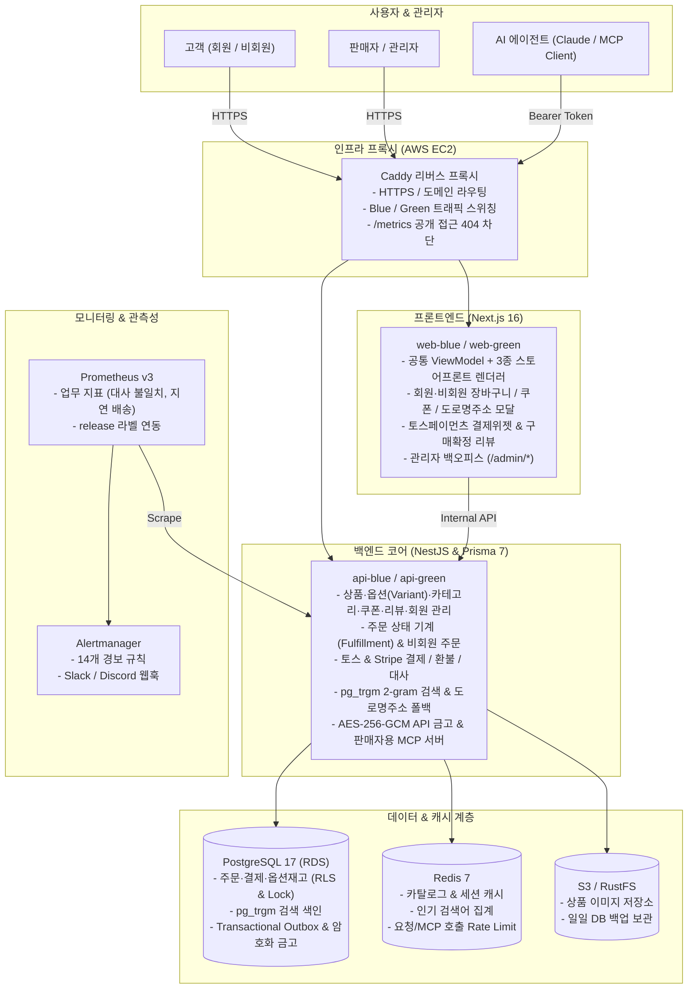
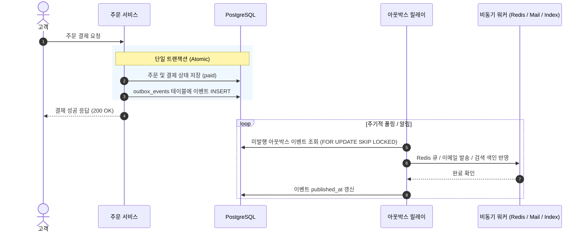

<p align="center">
  <h1 align="center">node-order</h1>
  <p align="center"><b>1인 판매자·소규모 브랜드를 위한 납품형 웹 쇼핑몰 & 백오피스 솔루션</b></p>
  <p align="center">
    NestJS · Next.js 16 (App Router) · Prisma 7 · PostgreSQL 17 · Redis 7 · Toss Payments · MCP · Prometheus · AWS<br>
    단위·통합·하네스·E2E 테스트 610+개 통과 · Blue/Green 무중단 배포
  </p>
</p>

---

## 📌 제품 개요

외주 개발이나 무거운 유료 SaaS 없이 **웹 쇼핑몰이 필요한 고객(1인 판매자·소규모 브랜드)에게 바로 제공해 상점을 열 수 있도록 만든 독립형 커머스 솔루션**입니다. 상품·다차원 옵션(색상·사이즈) 등록부터 오타 보정 검색, 회원·비회원 주문, 쿠폰·리뷰, 결제, 배송·반품 처리, PG 일일 대사, 그리고 AI 비서(MCP) 연동까지 상점 운영의 전 주기를 한 시스템에 담았습니다.

- **고객 브랜드에 맞춘 3종 스토어프론트 테마**: 하나의 커머스 ViewModel 위에서 3가지 스토어프론트 렌더러(`editorial-atelier`, `muji-hara`, `zavanas-archive`)를 분리해, 코드 수정이나 재배포 없이 관리자 화면(`/admin/settings`)에서 상점 디자인과 브랜딩 문구를 즉시 바꿀 수 있습니다.
- **동시 결제와 다차원 옵션 재고 정합성**: 인기 상품이나 옵션(`ProductVariant`)에 결제가 동시에 몰릴 때 초과 판매와 데드락이 생기지 않도록 상품·옵션 ID 오름차순 비관적 잠금(`SELECT ... FOR UPDATE`)과 트랜잭셔널 아웃박스를 적용했습니다.
- **국내외 PG 결제 · 쿠폰 할인 · 일일 대사**: 토스페이먼츠 결제위젯과 Stripe를 연동하고, 쿠폰 할인을 반영한 실결제액 기준으로 웹훅 역조회 검증과 매일 새벽 전수 대사(Reconciliation) 배치를 실행합니다.
- **외부 의존성을 줄인 검색 & AI 운영 도구**: 별도 검색 클러스터 없이 PostgreSQL `pg_trgm` 2-gram 색인으로 한글 부분 일치·오타 보정 검색을 구현했고, Model Context Protocol(MCP) 서버를 두어 Claude Code 같은 AI 에이전트가 미처리 주문 조회·송장 등록·반품 승인을 대신 처리할 수 있게 했습니다.
- **무배포 API 금고와 고정비 0원 폴백 기동**: 상점주가 외부 API 비밀키를 백오피스에 입력하면 AES-256-GCM으로 암호화해 저장하고, 유료 API 키(`LLM_API_KEY`, `STRIPE_SECRET_KEY`, `SENTRY_DSN`, `JUSO_API_KEY`)가 비어 있어도 내장 폴백으로 상점이 멈추지 않고 동작합니다.

---

## 🎨 스토어프론트 테마 디자인

동일한 커머스 코어(`storefront-view-model.ts`) 위에서 레이아웃과 상세 페이지 구조가 다른 3가지 테마 디자인을 제공합니다. URL 쿼리(`?design=`) 또는 관리자 설정(`/admin/settings`)으로 전환할 수 있습니다.

| 테마 | 구성 | 바로가기 링크 |
| :--- | :--- | :--- |
| `editorial-atelier` (기본) | 좌측 고정 카테고리 트리, 4열 `2:3` 룩북 그리드, 아코디언 상세 | [카탈로그](https://shop.43-202-205-93.sslip.io/shop?design=editorial-atelier) · [상품 상세](https://shop.43-202-205-93.sslip.io/shop/6?design=editorial-atelier) |
| `muji-hara` | 상단 4분할 카테고리 탭, 4열 `1:1` 정방형 격자, 정의 목록(`<dl>`) 상세 | [카탈로그](https://shop.43-202-205-93.sslip.io/shop?design=muji-hara) · [상품 상세](https://shop.43-202-205-93.sslip.io/shop/6?design=muji-hara) |
| `zavanas-archive` | 인라인 텍스트 필터, 4열 `1:1` 보더 카드, 사양 테이블(`<table>`) 상세 | [카탈로그](https://shop.43-202-205-93.sslip.io/shop?design=zavanas-archive) · [상품 상세](https://shop.43-202-205-93.sslip.io/shop/6?design=zavanas-archive) |

- **관리자 콘솔 (`kim` / `1234`)**: [로그인](https://shop.43-202-205-93.sslip.io/login) · [대시보드](https://shop.43-202-205-93.sslip.io/admin) · [상점 설정](https://shop.43-202-205-93.sslip.io/admin/settings)

---

## 🏛️ 시스템 아키텍처



---

## 📦 주요 기능

### 1. 고객 쇼핑몰 (`order-console-next`)
- **다중 스토어프론트 & 옵션 선택**: 3종 테마 렌더링, 2단계 계층 카테고리 필터, 정렬(최신·가격·리뷰순), 색상·사이즈 옵션(`ProductVariant`)별 재고 확인
- **실시간 상품 검색**: 디바운스 자동완성, 오타 보정 검색 결과 페이지, 인기 검색어 순위 노출
- **회원·비회원 주문 & 도로명주소 검색**: 회원가입·기본 배송지 자동 채움, 비회원 주문(`주문번호 + 비밀번호` 조회), 행안부 도로명주소 API 및 내장 주소 사전 폴백 모달
- **쿠폰 & 구매확정 리뷰**: 장바구니 정액·정률 할인 쿠폰 검증, 구매확정(`completed`) 주문 품목에 대한 별점·후기 작성
- **결제 · 배송 추적 · 반품**: 토스페이먼츠 결제위젯 및 Stripe 연동, 주문 상태 타임라인, 배송 완료 후 7일 이내 반품 신청 및 왕복 배송비 공제 환불

### 2. 관리자 콘솔 (`/admin`)
- **데이터 출처 분리 대시보드**: 상단 필터(`전체 데이터` / `시드 이후 실유입` / `시드 초기 데이터`)로 데모 샘플 주문과 실유입 지표를 분리 집계
- **카탈로그·프로모션·회원 관리**: 상품·옵션(SKU) 빌더 및 LLM 설명 초안 생성, 2단계 카테고리 트리 관리, 쿠폰 발행, 리뷰 관리, 회원 정지/익명화
- **주문 이행(Fulfillment) & PG 대사**: 회원·비회원 주문 조회, 운송장 등록 및 반품 승인/거절, 토스/Stripe 거래 내역과 DB 결제 행 일일 대사
- **상점 브랜딩 & 시스템·API 금고**: 상점명·기본 스토어 디자인·공지 문구 설정(`If-Match` 낙관적 잠금), AES-256-GCM 암호화 API 키 금고, 유료 API 차단 및 503 점검 모드 스위치

### 3. 판매자용 AI MCP 서버 (`POST /mcp`)
- Claude Code 등 MCP 클라이언트를 상점에 연결하여 터미널이나 대화창에서 상점 운영 업무 수행
- **지원 도구 (11개)**: `list_pending_work`, `search_orders`, `register_shipment`, `approve_return`, `adjust_stock` 등
- **보안 & 감사**: 토큰 권한(`read`, `write`, `pii`) 분리, 비신뢰 입력(`<untrusted>`) 격리, 모든 호출의 `mcp_audit_log` 감사 기록

---

## 🛠️ 핵심 설계 판단 (Engineering Deep Dives)

### 1. 초과 판매와 데드락을 막는 재고·옵션 동시성 제어

한정 수량 상품이나 옵션(`ProductVariant`)에 결제가 몰릴 때 재고 장부가 어긋나지 않게 하는 설계입니다.

- **비관적 잠금과 상위 재고 동기화**: 가격 확인과 쿠폰 적용까지 한 트랜잭션에서 판단해야 하므로 `SELECT ... FOR UPDATE`로 읽는 순간 행을 잠급니다. 옵션 재고를 차감하거나 복구할 때는 상위 상품(`Product.stock`) 합산 재고도 같은 트랜잭션에서 함께 갱신합니다.
- **다중 품목 데드락 방지**: 장바구니에 담긴 여러 품목을 서로 반대 순서로 잠그다 교착 상태에 빠지지 않도록, 모든 트랜잭션에서 **상품 ID 및 옵션 ID 오름차순으로 정렬해 잠금을 획득**합니다.
- **결제 멱등키**: 결제 버튼 중복 클릭이나 네트워크 재시도로 돈이 두 번 나가지 않게 `Idempotency-Key`와 요청 본문 해시를 주문 트랜잭션 안에 함께 저장합니다.

### 2. 주문 저장과 외부 발송을 묶는 트랜잭셔널 아웃박스 (Transactional Outbox)

DB 커밋 전에 알림이 먼저 나가거나, 반대로 커밋 직후 서버가 죽어 알림과 색인 갱신이 사라지는 문제를 막습니다.



- 주문 상태 변경과 `outbox_events` 행 추가를 **같은 RDB 트랜잭션**으로 묶고, 릴레이 워커가 `FOR UPDATE SKIP LOCKED`로 꺼내 적어도 한 번(At-least-once) 전달합니다.

### 3. PostgreSQL `pg_trgm` 검색과 도로명주소 내장 폴백

- **2-gram Trigram 색인**: 무거운 외부 검색 엔진을 따로 띄우는 대신 PostgreSQL `pg_trgm` 확장과 GIN 인덱스로 한글 2글자 이상 부분 일치 및 오타 보정(`similarity > 0.3`)을 처리합니다.
- **도로명주소 2중 폴백**: 행안부 도로명주소 API 키가 없거나 응답이 늦을 때 내장 주소 사전(60여 건)과 대표 주소 프리셋으로 자동 전환해 결제가 막히지 않게 합니다.

### 4. 쿠폰 할인 반영 PG 결제 검증 및 일일 대사(Reconciliation)

- **할인 차감 실결제액 고정 및 쿠폰 복구**: 상품 합계에서 쿠폰 할인액을 뺀 실결제 금액을 주문 스냅샷으로 저장하며, 주문 취소 시 사용된 쿠폰(`CouponRedemption`)을 원자적으로 되돌립니다.
- **웹훅 역조회 재검증 & 04:00 KST 대사 배치**: 웹훅이 도착하면 토스/Stripe API를 다시 조회해 원본 금액과 대조하고, 매일 새벽 전수 대사 배치가 실결제액과 PG 내역을 비교해 불일치 건수를 지표로 남깁니다.

### 5. 공통 커머스 ViewModel과 3종 스토어프론트 렌더러 분리

- 카테고리 필터, 정렬, 옵션 선택, 장바구니 담기, 리뷰 작성 등 비즈니스 상태를 `storefront-view-model.ts`의 공통 인터페이스로 모았습니다.
- 각 디자인 폴더(`designs/editorial-atelier`, `designs/muji-hara`, `designs/zavanas-archive`)는 마크업과 전용 CSS Modules만 가지며, `design-guard.sh`가 인라인 스타일(`style={{}}`)과 렌더러 간 교차 참조를 CI에서 차단합니다.

### 6. AES-256-GCM 암호화 금고 · MCP 서버 · 관측성

- **AES-256-GCM API 금고**: 외부 API 비밀키를 DB에 암호화해 보관(조회 응답 시 마스킹)하므로 재배포 없이 키를 교체하거나 긴급 차단할 수 있습니다.
- **판매자용 MCP 서버**: `POST /mcp` 엔드포인트에서 Bearer 토큰 권한 검증, `<untrusted>` 이스케이프, `mcp_audit_log` 감사 기록을 강제합니다.
- **관측성 및 일일 시드 복원**: Sentry `scrubEvent`로 개인정보를 가리고, 매일 03:30 KST S3 DB 백업이 성공한 날에만 04:00 KST 데모 데이터를 초기 상태로 되돌립니다.

---

## 🚀 로컬 실행 방법 (Quick Start)

### 1. 개발 인프라 기동
```sh
# 저장소 클론 및 패키지 설치
npm ci

# PostgreSQL(5433), Redis(6380), Storage(9000) 실행
docker compose up -d
```

### 2. 환경변수 준비
```sh
cp order-api-nest/.env.example order-api-nest/.env
cp order-console-next/.env.example order-console-next/.env.local
```

### 3. DB 마이그레이션 및 시드 데이터 적재
```sh
cd order-api-nest
npx prisma migrate dev
npm run seed
cd ..
```

### 4. 개발 서버 실행
```sh
# 터미널 1: NestJS API (포트 4000)
npm run dev:api

# 터미널 2: Next.js 콘솔 (포트 3000)
npm run dev:web
```

브라우저에서 `http://localhost:3000`으로 접속합니다.
- 테마별 로컬 확인: [`?design=editorial-atelier`](http://localhost:3000/shop?design=editorial-atelier) · [`?design=muji-hara`](http://localhost:3000/shop?design=muji-hara) · [`?design=zavanas-archive`](http://localhost:3000/shop?design=zavanas-archive)
- 관리자 로그인: [`http://localhost:3000/login`](http://localhost:3000/login) (`kim` / `1234`)

---

## 🧪 테스트 및 하네스 검증

3단계 검증 스크립트로 코드와 운영 규칙을 검사합니다:

```sh
# 1. 빠른 검사 (Prisma + Lint + Typecheck + 단위 테스트 174개 + 하네스·디자인 가드 108개)
npm run verify:fast

# 2. 프로덕션 모니터링 규칙 검사 (Prometheus 14개 경보 + Alertmanager 렌더러 + 메모리 상한)
npm run test:rules

# 3. 전체 검증 (Fast + 백엔드 e2e 261개 + 프론트 Playwright e2e 70개 + 결제 시뮬레이터 대역)
npm run verify
```

---

## 🚢 무중단 배포 (AWS Blue/Green)

단일 EC2 인스턴스 안에서 Caddy 리버스 프록시와 두 벌의 컨테이너 슬롯(Blue/Green)으로 배포 중 요청 실패를 막습니다.

- **릴리스 흐름**: `release.sh up <새_태그>` (대기 슬롯 기동, 마이그레이션 및 데모 시드 동기화) ➔ Playwright 스모크 테스트 ➔ `release.sh switch` (Caddy 리버스 프록시 트래픽 전환)
- **고정비 0원 폴백 기동**: 외부 유료 키(`LLM_API_KEY`, `STRIPE_SECRET_KEY`, `SENTRY_DSN`, `JUSO_API_KEY`)가 비어 있어도 폴백 모드로 기동되어 고정 SaaS 비용 없이 상점을 운영할 수 있습니다.
- **서버 환경변수 동기화**:
  ```sh
  # 토스 테스트 키, 도로명주소 API 키 등을 서버 .env에 전달 (배포 전 선반영)
  TOSS_CLIENT_KEY=test_ck_... TOSS_SECRET_KEY=test_sk_... JUSO_API_KEY=... bash deploy/aws/60-server-env.sh
  ```

---

<details>
<summary><b>📚 아키텍처 구축 이력 (01 ~ 36단계 전체 로드맵 보기)</b></summary>

이 저장소의 `main` 브랜치는 아래 36단계의 커밋 이력이 처음부터 끝까지 하나로 이어진 최종 완성본이며, 각 단계 시점의 스냅샷 브랜치(`01-postgres-prisma` ~ `36-storefront-designs`)도 함께 보존되어 있습니다.

| 단계 | 브랜치 | 핵심 구현 내용 |
| :--- | :--- | :--- |
| 01 ~ 04 | `01-postgres-prisma` ~ `04-redis` | PostgreSQL·Prisma 영속화, 비관적 잠금(`SELECT FOR UPDATE`)·데드락 방지·멱등키, Refresh Token 회전·재사용 감지, Redis 캐시·Rate Limit·BullMQ |
| 05 ~ 10 | `05-front-state` ~ `10-rls` | TanStack Query·Zustand 상태 분리, S3 Presigned URL 업로드, 그레이스풀 셧다운·트랜잭셔널 아웃박스, k6 부하 테스트·CSP, 재귀 CTE 카테고리 트리, PostgreSQL RLS |
| 11 ~ 18 | `11-service-worker` ~ `18-deploy` | Web Push 알림, tRPC, Auth.js OAuth, Stripe 결제·웹훅·2중 멱등키, Prometheus·Grafana·Alertmanager, GitHub Actions CI 및 AWS 배포·롤백 |
| 19 ~ 24 | `19-design` ~ `24-zero-downtime-release` | 스토어프론트 UI 개편, 일일 백업 연동 시드 리셋, 커서 페이지네이션·잠금 비교, 카탈로그 캐시 분리, Caddy Blue/Green 무중단 배포 및 4단계 무중단 컬럼 마이그레이션 |
| 25 ~ 30 | `25-harness` ~ `30-ai-mcp` | 에이전트 검증 하네스(`verify:fast`/가드), `pg_trgm` 2-gram 한글 오타 보정 검색, 토스페이먼츠 위젯·일일 대사 배치, 배송·반품 상태 머신, 관리자 백오피스, 판매자용 MCP 서버 |
| 31 ~ 36 | `31-observability` ~ `36-storefront-designs` | Sentry PII 마스킹·14개 프로덕션 경보·런북, AES-256-GCM 암호화 금고·0원 폴백, 회원·비회원 주문·도로명주소·옵션(Variant) 재고, 카탈로그·쿠폰·리뷰, 공통 ViewModel 기반 3종 스토어프론트 테마 디자인 |

</details>
