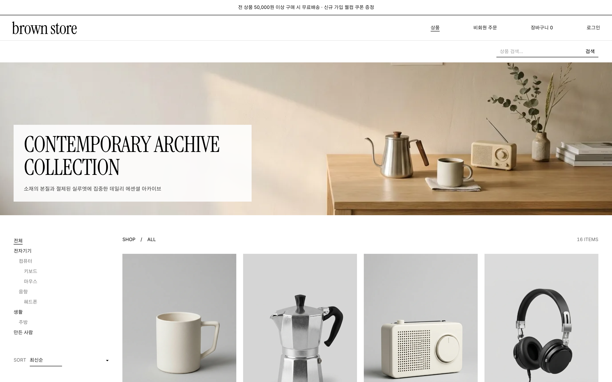
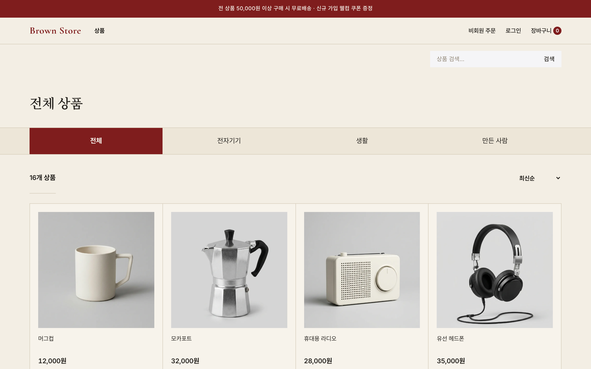
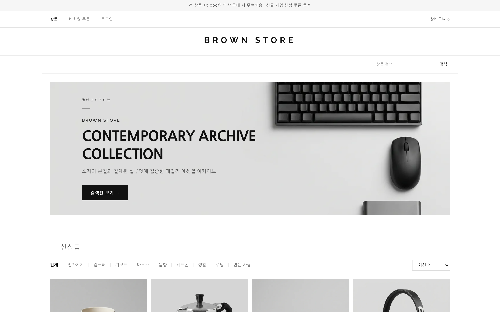
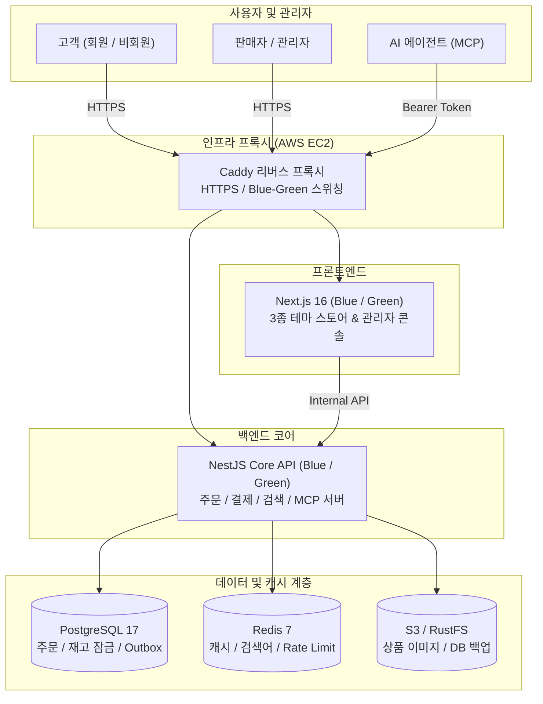
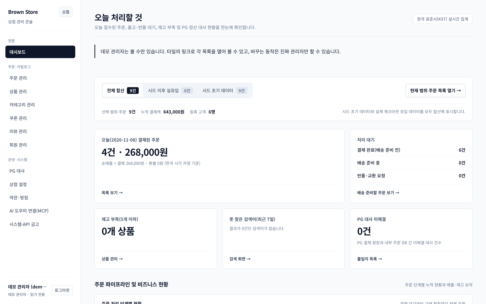
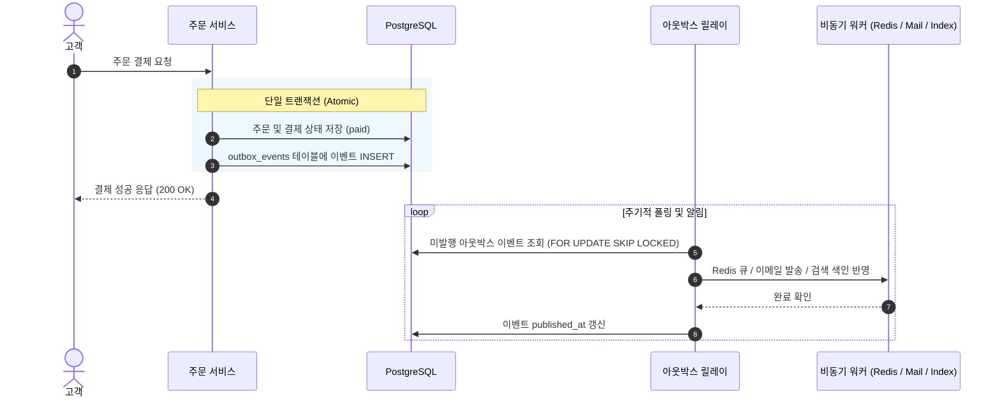

<p align="center">
  <h1 align="center">node-order</h1>
  <p align="center"><b>소규모 판매자를 위한 온라인 쇼핑몰 및 백오피스 웹 서비스</b></p>
  <p align="center">
    <a href="https://shop.43-202-205-93.sslip.io/shop"><b>라이브 데모</b></a> |
    <a href="https://shop.43-202-205-93.sslip.io/admin"><b>관리자 콘솔 데모 (kim / 1234)</b></a>
  </p>
  <p align="center">
    NestJS | Next.js 16 (App Router) | Prisma 7 | PostgreSQL 17 | Redis 7 | Toss Payments | Stripe | MCP | Caddy | AWS<br>
    단위, 통합, E2E 테스트 | Caddy Blue/Green 무중단 배포
  </p>
</p>

---

## 제품 개요

외주 개발이나 무거운 유료 SaaS 없이 **웹 쇼핑몰이 필요한 고객(1인 판매자와 소규모 브랜드)에게 바로 제공해 상점을 열 수 있도록 만든 독립형 커머스 솔루션**입니다. 상품과 다차원 옵션(색상, 사이즈) 등록부터 오타 보정 검색, 회원 및 비회원 주문, 쿠폰과 리뷰, 결제, 배송과 반품 처리, PG 일일 대사, 그리고 AI 비서(MCP) 연동까지 상점 운영의 전 주기를 한 시스템에 담았습니다.

- 하나의 커머스 ViewModel 위에서 3가지 스토어프론트 렌더러(`editorial-atelier`, `muji-hara`, `zavanas-archive`)를 분리해, 코드 수정이나 재배포 없이 관리자 화면(`/admin/settings`)에서 상점 디자인과 브랜딩 문구를 바로 바꿀 수 있습니다.
- 인기 상품이나 옵션(`ProductVariant`)에 결제가 동시에 몰릴 때 초과 판매와 데드락이 생기지 않도록 상품 및 옵션 ID 오름차순 비관적 잠금(`SELECT ... FOR UPDATE`)과 주문-PG 트랜잭션 분리, 트랜잭셔널 아웃박스를 적용했습니다.
- 토스페이먼츠 결제위젯과 Stripe를 연동하고, 쿠폰 할인을 반영한 실결제액 기준으로 웹훅 역조회 검증과 매일 새벽 전수 대사(Reconciliation) 배치를 실행합니다.
- 별도 검색 클러스터 없이 PostgreSQL `pg_trgm` 2-gram 색인으로 한글 부분 일치와 오타 보정 검색을 구현했고, Model Context Protocol(MCP) 서버를 두어 Claude Code 같은 AI 에이전트가 미처리 주문 조회, 송장 등록, 반품 승인을 대신 처리할 수 있게 했습니다.
- 상점주가 외부 API 비밀키를 백오피스에 입력하면 AES-256-GCM으로 암호화해 저장하고, 유료 API 키(`LLM_API_KEY`, `STRIPE_SECRET_KEY`, `SENTRY_DSN`, `JUSO_API_KEY`)가 비어 있어도 내장 폴백으로 상점이 멈추지 않고 동작합니다.

---

## 스토어프론트 테마 디자인

동일한 커머스 코어(`storefront-view-model.ts`) 위에서 레이아웃과 상세 페이지 구조가 다른 3가지 테마 디자인을 제공합니다. URL 쿼리(`?design=`) 또는 관리자 설정(`/admin/settings`)으로 전환할 수 있습니다.

| `editorial-atelier` (기본) | `muji-hara` | `zavanas-archive` |
| :---: | :---: | :---: |
| [](https://shop.43-202-205-93.sslip.io/shop?design=editorial-atelier) | [](https://shop.43-202-205-93.sslip.io/shop?design=muji-hara) | [](https://shop.43-202-205-93.sslip.io/shop?design=zavanas-archive) |
| 좌측 고정 카테고리 트리, 2:3 룩북 그리드 | 상단 4분할 탭, 1:1 정방형 격자 | 인라인 텍스트 필터, 1:1 테두리 카드 |
| [카탈로그](https://shop.43-202-205-93.sslip.io/shop?design=editorial-atelier) / [상품 상세](https://shop.43-202-205-93.sslip.io/shop/6?design=editorial-atelier) | [카탈로그](https://shop.43-202-205-93.sslip.io/shop?design=muji-hara) / [상품 상세](https://shop.43-202-205-93.sslip.io/shop/6?design=muji-hara) | [카탈로그](https://shop.43-202-205-93.sslip.io/shop?design=zavanas-archive) / [상품 상세](https://shop.43-202-205-93.sslip.io/shop/6?design=zavanas-archive) |

- **관리자 콘솔 (`kim` / `1234`)**: [로그인](https://shop.43-202-205-93.sslip.io/login) | [대시보드](https://shop.43-202-205-93.sslip.io/admin) | [상점 설정](https://shop.43-202-205-93.sslip.io/admin/settings)
- **데모 안내**: 로그인 화면에서 임시 계정으로 바로 둘러볼 수 있으며, 매일 03:30 KST 데이터베이스 백업이 성공하면 04:00 KST에 상품과 데모 주문을 초기 상태로 복원합니다. 결제는 테스트 모드로 동작합니다.

---

## 시스템 아키텍처



---

## 주요 기능

### 1. 고객 쇼핑몰 (`order-console-next`)
- **다중 스토어프론트 및 옵션 선택**: 3종 테마 렌더링, 2단계 계층 카테고리 필터, 최신순/가격순/리뷰순 정렬, 색상과 사이즈 옵션(`ProductVariant`)별 재고 확인
- **실시간 상품 검색**: 디바운스 자동완성, 오타 보정 검색 결과 페이지, 인기 검색어 순위 노출
- **회원 및 비회원 주문과 도로명주소 검색**: 회원가입 시 기본 배송지 자동 채움, 비회원 주문(주문번호와 비밀번호로 조회), 행안부 도로명주소 API 및 내장 주소 사전 폴백 모달
- **쿠폰과 구매확정 리뷰**: 장바구니 정액 및 정률 할인 쿠폰 검증, 구매확정(`completed`) 주문 품목에 대한 별점과 후기 작성
- **결제, 배송 추적, 반품**: 토스페이먼츠 결제위젯 및 Stripe 연동, 주문 상태 타임라인, 배송 완료 후 7일 이내 반품 신청 및 왕복 배송비 공제 환불

### 2. 관리자 콘솔 (`/admin`)

<p align="center"></p>

- **데이터 출처 분리 대시보드**: 상단 필터(전체 데이터 / 시드 이후 실유입 / 시드 초기 데이터)로 데모 샘플 주문과 실유입 지표를 분리 집계
- **카탈로그, 프로모션, 회원 관리**: 상품 및 옵션(SKU) 빌더, LLM 설명 초안 생성, 2단계 카테고리 트리 관리, 쿠폰 발행, 리뷰 관리, 회원 정지 및 익명화
- **주문 이행(Fulfillment) 및 PG 대사**: 회원 및 비회원 주문 조회, 운송장 등록 및 반품 승인/거절, 토스/Stripe 거래 내역과 DB 결제 행 일일 대사
- **상점 브랜딩과 시스템 및 API 금고**: 상점명, 기본 스토어 디자인, 공지 문구 설정(`If-Match` 낙관적 잠금), AES-256-GCM 암호화 API 키 금고, 유료 API 차단 및 503 점검 모드 스위치

### 3. 판매자용 AI MCP 서버 (`POST /mcp`)
- Claude Code 등 MCP 클라이언트를 상점에 연결하여 터미널이나 대화창에서 상점 운영 업무 수행
- **지원 도구**: 미처리 주문 조회(`list_pending_work`), 주문 검색(`search_orders`), 송장 등록(`register_shipment`), 반품 승인(`approve_return`), 재고 조정(`adjust_stock`) 등 11개 도구 지원
- **보안 및 감사**: 토큰 권한(`read`, `write`, `pii`) 분리, 비신뢰 입력(`<untrusted>`) 격리, 모든 호출의 `mcp_audit_log` 감사 기록

---

## 핵심 설계 판단

### 1. 초과 판매와 데드락을 막는 재고 및 옵션 동시성 제어

한정 수량 상품이나 옵션(`ProductVariant`)에 결제가 몰릴 때 재고 장부가 어긋나지 않게 하는 설계입니다.

- **비관적 잠금과 상위 재고 동기화**: 가격 확인과 쿠폰 적용까지 한 트랜잭션에서 판단해야 하므로 `SELECT ... FOR UPDATE`로 읽는 순간 행을 잠급니다. 옵션 재고를 차감하거나 복구할 때는 상위 상품(`Product.stock`) 합산 재고도 같은 트랜잭션에서 함께 갱신합니다.
- **다중 품목 데드락 방지**: 장바구니에 담긴 여러 품목을 서로 반대 순서로 잠그다 교착 상태에 빠지지 않도록, 모든 트랜잭션에서 **상품 ID 및 옵션 ID 오름차순으로 정렬해 잠금을 획득**합니다.
- **주문 생성 트랜잭션과 외부 PG 호출 분리**: DB 트랜잭션 안에서 외부 결제사(PG) 승인 응답을 기다리면 PG 지연이 곧바로 DB 커넥션 풀 고갈로 이어집니다. DB에서는 주문 생성과 재고와 쿠폰 예약만 마치고 즉시 커밋한 뒤, 트랜잭션 밖에서 PG 승인이 실패하거나 타임아웃이 나면 예약된 재고와 쿠폰(`CouponRedemption`)을 보상 트랜잭션으로 원복합니다.
- **결제 멱등키**: 결제 버튼 중복 클릭이나 네트워크 재시도로 돈이 두 번 나가지 않게 `Idempotency-Key`와 요청 본문 해시를 주문 트랜잭션 안에 함께 저장합니다.

### 2. 주문 저장과 외부 발송을 묶는 트랜잭셔널 아웃박스 (Transactional Outbox)

DB 커밋 전에 알림이 먼저 나가거나, 반대로 커밋 직후 서버가 다운되어 알림과 색인 갱신이 사라지는 문제를 방지합니다.



- 주문 상태 변경과 `outbox_events` 행 추가를 **같은 RDB 트랜잭션**으로 묶고, 릴레이 워커가 `FOR UPDATE SKIP LOCKED`로 꺼내 적어도 한 번(At-least-once) 전달합니다.

### 3. PostgreSQL `pg_trgm` 검색과 도로명주소 내장 폴백

- **2-gram Trigram 색인**: 무거운 외부 검색 엔진을 따로 띄우는 대신 PostgreSQL `pg_trgm` 확장과 GIN 인덱스로 한글 2글자 이상 부분 일치 및 오타 보정(`similarity > 0.3`)을 처리합니다.
- **도로명주소 2중 폴백**: 행안부 도로명주소 API 키가 없거나 응답이 늦을 때 내장 주소 사전(60여 건)과 대표 주소 프리셋으로 자동 전환해 결제가 막히지 않게 합니다.

### 4. 쿠폰 할인 반영 PG 결제 검증 및 일일 대사 (Reconciliation)

- **할인 차감 실결제액 고정 및 쿠폰 복구**: 상품 합계에서 쿠폰 할인액을 뺀 실결제 금액을 주문 스냅샷으로 저장하며, 주문 취소 시 사용된 쿠폰(`CouponRedemption`)을 원자적으로 원복합니다.
- **웹훅 역조회 재검증 및 04:00 KST 대사 배치**: 웹훅이 도착하면 토스/Stripe API를 다시 조회해 원본 금액과 대조하고, 매일 새벽 전수 대사 배치가 실결제액과 PG 내역을 비교해 불일치 건수를 지표로 남깁니다.
- **p-limit과 p-retry 기반 PG 대사 동시성 제어**: 거래 전수 조회 시 PG 요청 한도를 넘지 않게 `p-limit`으로 동시 조회를 묶고, 429와 5xx 일시 오류는 `p-retry`와 `Retry-After` 헤더 기반 지수 백오프로 안전하게 다시 시도합니다.

### 5. 공통 커머스 ViewModel과 3종 스토어프론트 분리 및 RTR 토큰 갱신 병합

- 카테고리 필터, 정렬, 옵션 선택, 장바구니 담기, 리뷰 작성 등 비즈니스 상태를 `storefront-view-model.ts`의 공통 인터페이스로 모았습니다.
- 각 디자인 폴더(`designs/editorial-atelier`, `designs/muji-hara`, `designs/zavanas-archive`)는 마크업과 전용 CSS Modules만 가지며, `design-guard.sh`가 인라인 스타일(`style={{}}`)과 렌더러 간 교차 참조를 CI에서 차단합니다.
- **RTR 토큰 갱신 중복 병합과 API 클라이언트**: 새로고침 시 여러 API 요청이 동시에 `401`을 받으면 Refresh Token Rotation(RTR)이 중복 호출되어 이전 토큰이 폐기되면서 로그아웃되는 문제가 있었습니다. `ky` 기반 클라이언트(`order-console-next/lib/api-client.ts`)에서 진행 중인 `/auth/refresh` Promise(`refreshing`)를 단일 참조로 공유해 동시 갱신 요청을 1회로 병합하고, `clsx`와 `tailwind-merge` 기반 `cn` 유틸로 조건부 클래스 충돌을 정리합니다.

### 6. AES-256-GCM 암호화 금고, MCP 서버, 관측성

- **AES-256-GCM API 금고**: 외부 API 비밀키를 DB에 암호화해 보관(조회 응답 시 마스킹)하므로 재배포 없이 키를 교체하거나 긴급 차단할 수 있습니다.
- **판매자용 MCP 서버**: `POST /mcp` 엔드포인트에서 Bearer 토큰 권한 검증, `<untrusted>` 이스케이프, `mcp_audit_log` 감사 기록을 강제합니다.
- **관측성 및 일일 시드 복원**: Sentry `scrubEvent`로 개인정보를 가리고, 매일 03:30 KST S3 DB 백업이 성공한 날에만 04:00 KST 데모 데이터를 초기 상태로 복원합니다.

### 7. AI 코딩 에이전트 작업 하네스

이 프로젝트는 특정 시점부터 AI 코딩 에이전트를 도입하여 함께 개발했습니다. `AGENTS.md` 같은 자연어 지침은 대화가 길어지면 지켜지지 않을 수 있어서, 지켜야 할 규칙은 셸 훅의 종료 코드(`scripts/harness/`)로 강제했습니다.

- **먼저 합격 기준을 고정**: 재고는 음수가 되지 않고, 같은 `Idempotency-Key`는 한 번만 결제되며, RLS로 타인 주문은 보이지 않는다는 핵심 도메인 규칙을 정하고, 구현 전에 실패하는 통합 테스트(재고 10개에 동시 주문 50건 등)를 먼저 둡니다.
- **`PreToolUse` (`guard.sh`)**: `.env` 수정, 이미 적용된 `prisma/migrations/*` 변경, `git push`를 실행 전에 `exit 2`로 막고 대안(`.env.example`에 이름만 추가, 새 마이그레이션 생성)을 에이전트에게 돌려줍니다.
- **`PostToolUse` (`lint-file.sh`)**: 방금 편집한 파일만 바로 린트해 자체 교정이 빠르게 돌게 합니다.
- **`Stop` (`stop-verify.sh`)**: 변경이 있으면 `verify:fast`가 통과해야 작업을 끝낼 수 있고, 같은 세션에서 연속 3회 막히면 더 막지 않고 사람에게 넘깁니다.
- **방어선을 일부러 제거해 보는 역검증**: `SELECT ... FOR UPDATE`나 RLS의 `set_config` 한 줄을 지웠을 때 동시성 테스트와 격리 테스트가 실제로 실패하는지 확인해, 어떤 입력에도 통과하는 테스트를 걸러냅니다.

---

## 로컬 실행 방법 (Quick Start)

### 1. 개발 인프라 기동
```sh
# 저장소 클론 및 패키지 설치
npm ci

# PostgreSQL(5433), Redis(6380), Storage(9000) 실행
docker compose up -d
```

### 2. 환경변수 준비
```sh
cp order-api-nest/.env.example order-api-nest/.env
cp order-console-next/.env.example order-console-next/.env.local
```

### 3. DB 마이그레이션 및 시드 데이터 적재
```sh
cd order-api-nest
npx prisma migrate dev
npm run seed
cd ..
```

### 4. 개발 서버 실행
```sh
# 터미널 1: NestJS API (포트 4000)
npm run dev:api

# 터미널 2: Next.js 콘솔 (포트 3000)
npm run dev:web
```

브라우저에서 `http://localhost:3000`으로 접속합니다.
- 테마별 로컬 확인: [`?design=editorial-atelier`](http://localhost:3000/shop?design=editorial-atelier) / [`?design=muji-hara`](http://localhost:3000/shop?design=muji-hara) / [`?design=zavanas-archive`](http://localhost:3000/shop?design=zavanas-archive)
- 관리자 로그인: [`http://localhost:3000/login`](http://localhost:3000/login) (`kim` / `1234`)

---

## 테스트 및 정적 규칙 검증

3단계 검증 스크립트로 코드 품질과 비즈니스 규칙을 검사합니다.

```sh
# 1. 빠른 검사 (Prisma + Lint + Typecheck + 단위 테스트 + 정적 규칙 및 디자인 가드 검사)
npm run verify:fast

# 2. 프로덕션 모니터링 규칙 검사 (Prometheus 경보 규칙 + Alertmanager 템플릿 + 메모리 상한선 검사)
npm run test:rules

# 3. 전체 검증 (Fast 검사 전체 + 백엔드 e2e + 프론트엔드 Playwright e2e + 결제 시뮬레이터 대역 검증)
npm run verify
```

---

## 무중단 배포 (AWS EC2 Caddy Blue/Green)

단일 EC2 인스턴스 안에서 Caddy 리버스 프록시와 두 벌의 컨테이너 슬롯(Blue/Green)으로 배포 중 요청 실패를 막습니다.

- **릴리스 흐름**: `release.sh up <새_태그>` (대기 슬롯 기동, 마이그레이션 및 데모 시드 동기화), Playwright 스모크 테스트, `release.sh switch` (Caddy 리버스 프록시 트래픽 전환) 순서로 진행하며 문제 발생 시 `rollback.sh`로 즉시 복귀합니다.
- **고정비 0원 폴백 기동**: 외부 유료 키(`LLM_API_KEY`, `STRIPE_SECRET_KEY`, `SENTRY_DSN`, `JUSO_API_KEY`)가 비어 있어도 폴백 모드로 기동되어 고정 SaaS 비용 없이 상점을 운영할 수 있습니다.
- **서버 환경변수 동기화**:
  ```sh
  # 토스 테스트 키, 도로명주소 API 키 등을 서버 .env에 전달 (배포 전 선반영)
  TOSS_CLIENT_KEY=test_ck_... TOSS_SECRET_KEY=test_sk_... JUSO_API_KEY=... bash deploy/aws/60-server-env.sh
  ```

---

## 선택적 보조 서비스 및 인프라 확장 (`services/`, `deploy/`)

쇼핑몰 본체(`order-api-nest`, `order-console-next`)와 실서버 데모는 추가 사이드카 없이 `--profile app`만으로 단독 기동됩니다. 저장소 내부의 `services/`와 `deploy/terraform`, `deploy/k8s`는 상점 운영 기능 중 재사용 가능한 영역을 별도 독립 저장소(Go, Python) 및 선언형 인프라로 분리해 개발하고, 로컬 통합 환경(`docker compose --profile polyglot up`)에서 환경변수가 주입된 경우에만 연동되도록 격리한 선택 확장 모듈입니다.

| 구분 | 모듈 및 독립 저장소 | 선택 연동 역할 (미설정 시 본체 단독 동작) |
| :--- | :--- | :--- |
| **Go 미들웨어 및 관측** | [`pgrelay`](https://github.com/seungwoo7050/pgrelay), [`idemguard`](https://github.com/seungwoo7050/idemguard), [`aigate`](https://github.com/seungwoo7050/aigate), [`rolltrace`](https://github.com/seungwoo7050/rolltrace) | PostgreSQL 아웃박스 웹훅 중계(`PGRELAY_URL`), RFC 8785 HTTP 멱등 리버스 프록시, 외부 LLM 호출 서킷 브레이커 및 Single-Flight(`LLM_BASE_URL`), OTel RED 집계 및 카나리 SLO 평가(`ROLLTRACE_URL`) |
| **Python 검증 및 감시** | [`citeguard`](https://github.com/seungwoo7050/citeguard), [`ingestguard`](https://github.com/seungwoo7050/ingestguard), [`pulsebox`](https://github.com/seungwoo7050/pulsebox), [`opsguard`](https://github.com/seungwoo7050/opsguard), [`driftwatch`](https://github.com/seungwoo7050/driftwatch) | 약관 및 환불 규정 Hybrid RRF 근거 질의(`CITEGUARD_URL`), 대량 상품 CSV 스트리밍 적재와 불량 행 격리(`INGESTGUARD_URL`), 스택트레이스 지문 병합과 배치 워치독(`PULSEBOX_URL`), 무중단 배포 위험 DDL 및 인프라 정책 검증(`OPSGUARD_URL`), 외부 응답 변동 감시 |
| **선언형 인프라** | `deploy/terraform`, `deploy/k8s` | 단일 EC2 구성을 다중 노드로 확장할 때 대비한 AWS 네트워크 및 최소 권한 OIDC 모듈, Helm/Argo Rollouts 매니페스트 |

---

## 범위와 한계

- `SELECT ... FOR UPDATE` 비관적 잠금은 같은 상품이나 옵션에 결제가 동시에 몰릴 때 요청을 한 줄로 세우므로 대기 시간이 늘어납니다. 초과 판매 0건과 가격, 쿠폰 복합 검증 정합성을 처리량보다 우선한 선택입니다.
- 트랜잭셔널 아웃박스는 워커 재시작이나 타임아웃 시 같은 이벤트를 두 번 보낼 수 있으므로(At-least-once), 이벤트를 받는 하위 핸들러와 웹훅 수신 측에서 중복 처리를 걸러내야 합니다.
- 단일 EC2 인스턴스 안에서 두 슬롯을 교대로 띄우는 블루/그린 구조라 전환 시점에 메모리를 두 배로 쓰며, EC2 호스트 자체가 재부팅될 때는 서비스가 멈춥니다.
- 동시 결제 부하 테스트(k6)와 장애 주입 시나리오는 로컬 및 리허설 환경과 테스트 결제 키 기준으로 검증한 결과이며, 실제 상용 결제 대금이 오간 운영 트래픽은 아닙니다.
