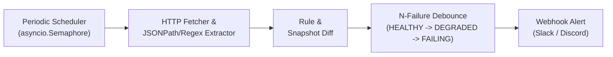

<p align="center">
  <h1 align="center">driftwatch</h1>
  <p align="center"><b>외부 웹페이지 및 공공 API 데이터 변동 감시와 N회 연속 실패 디바운스 엔진</b></p>
  <p align="center">
    Python 3.11+ | FastAPI | Pydantic | SQLAlchemy 2.0 | httpx | Prometheus
  </p>
</p>

---

외부 웹페이지나 공공/파트너 JSON API의 사실 값(교통 요금, 막차 시각, 환율, 정책 수치)이 예고 없이 바뀌거나 스키마를 벗어나는지 주기적으로 수집하고 검증하는 감시 엔진입니다. 일시적 네트워크 순단이나 점검으로 인한 오탐을 막기 위해 N회 연속 실패 디바운스(Debounce)를 거친 뒤에만 상태를 전이하고 웹훅 알림을 발행합니다.

## 아키텍처 흐름도



## 핵심 기능

- **JSON 경로 및 정규식 추출기**: 점(`.`) 구분 중첩 탐색(`data.fare.adult`, `routes.0.id`)과 숫자 단어 경계(`(?<!\d)...(?!\d)`) 패턴 매칭으로 부분 문자열 오탐 없이 목표 값을 분리합니다.
- **N회 연속 실패 디바운스**: 1~2회 일시적 503이나 타임아웃은 `DEGRADED` 상태로 두고 알림을 유보합니다. 설정한 `failure_threshold`(기본 3)에 도달할 때만 `FAILING` 상태로 넘어가며 `CONSECUTIVE_FAILURES` 알림을 1회 발행합니다.
- **스냅샷 Diff와 규칙 검증**: 직전 값과 달라지면 `VALUE_DRIFT`, 허용 범위(`min_value`, `max_value`)나 기대값(`expected_value`)을 벗어나면 `RULE_VIOLATION` 알림을 생성합니다.
- **동시 수집 제한**: `asyncio.Semaphore`로 외부 대상 서버로의 동시 HTTP 요청 수를 제한합니다.
- **FastAPI 및 Prometheus 계측**: 단독 데몬 서버로 실행할 수 있고, 수집, 알림, 장애 횟수를 `/metrics` 엔드포인트로 노출합니다.

## 빠른 시작

### 1. 요구 환경

- Python 3.11 이상
- 의존 패키지: `fastapi`, `uvicorn`, `pydantic`, `sqlalchemy`, `httpx`

### 2. 서버 실행

```bash
# SQLite 데이터베이스 생성 및 테이블 초기화
python3 -m driftwatch.cli init-db --db sqlite:///driftwatch.db

# API 서버 및 백그라운드 수집기 실행 (30초 주기)
python3 -m driftwatch.cli serve --host 0.0.0.0 --port 8000 --db sqlite:///driftwatch.db --poll-interval 30
```

### 3. 감시 대상 등록 예시

```bash
curl -X POST http://localhost:8000/v1/targets \
  -H "Content-Type: application/json" \
  -d '{
    "target_id": "subway-base-fare",
    "name": "지하철 기본 요금",
    "url": "https://api.example.com/fare",
    "extractor_type": "json_path",
    "selector": "fare.adult",
    "expected_type": "int",
    "expected_value": "1400",
    "min_value": 1000,
    "max_value": 2000,
    "failure_threshold": 3,
    "interval_seconds": 60,
    "webhook_url": "https://hooks.slack.com/services/xxx/yyy/zzz"
  }'
```

### 4. 수동 점검 및 조회

```bash
# 특정 대상 즉시 점검
curl -X POST http://localhost:8000/v1/targets/subway-base-fare/check
# 발행된 알림 이력 조회
curl http://localhost:8000/v1/alerts

# Prometheus 메트릭 수집
curl http://localhost:8000/metrics
```

## CLI 명령어

| 명령어 | 설명 | 주요 옵션 |
|---|---|---|
| `driftwatch serve` | FastAPI HTTP 서버 및 주기 수집 루프 실행 | `--host`, `--port`, `--db`, `--poll-interval` |
| `driftwatch check` | 단일 또는 전체 주기 대상 수동 점검 | `--db`, `--target-id`, `--all` |
| `driftwatch init-db` | 스키마 테이블 생성 | `--db` |

## 테스트 실행

```bash
# 린트 및 타입 검사
ruff check driftwatch tests
mypy driftwatch tests

# 단위, 동시성, E2E 테스트 실행
pytest -v tests/
```
