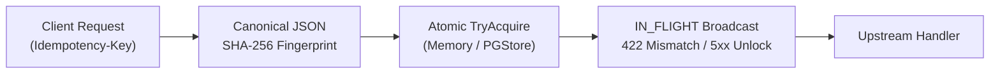

<p align="center">
  <h1 align="center">idemguard</h1>
  <p align="center"><b>IETF Idempotency-Key 규격 기반 L7 멱등성 프록시 및 미들웨어</b></p>
  <p align="center">
    Go 1.24 | net/http | Canonical JSON | In-Flight Broadcast | PostgreSQL | Prometheus
  </p>
</p>

---

결제, 주문, 포인트 차감 등 상태 변경 HTTP API에서 중복 실행을 차단하는 Go 미들웨어 라이브러리(`pkg/idem`) 겸 L7 리버스 프록시 데몬(`cmd/idemguard`)입니다. IETF `Idempotency-Key` 규격을 기반으로 동일 키의 동시 요청을 1회만 실행하고 후속 요청에 캐시된 응답을 안전하게 반환합니다.

## 아키텍처 흐름도



## 왜 만들었나

- **Check-Then-Act 경쟁 조건(TOCTOU)**: 멱등 키가 저장되어 있는지 먼저 조회하고 없으면 핸들러를 실행하는 방식은 네트워크 재시도나 사용자의 더블클릭으로 수십 밀리초 안에 들어오는 동시 요청을 막지 못합니다. 첫 번째 요청이 커밋되기 전에 두 번째 요청이 조회를 통과해 이중 결제나 중복 주문이 발생합니다.
- **5xx 일시 오류의 영구 캐싱 문제**: 결제 대행사 일시 타임아웃이나 DB 연결 풀 고갈로 발생한 500 응답을 멱등성 저장소에 그대로 저장하면, 클라이언트가 정상 재시도를 시도해도 TTL 동안 실패한 500 응답만 반복 수신합니다.
- **동일 키 페이로드 변조 위험**: 동일한 멱등 키를 재사용하면서 결제 금액이나 주문 품목을 변경해 요청하는 경우, 이전 응답을 무조건 내려주면 데이터 정합성이 깨집니다.

## 구조와 설계 판단

```text
cmd/idemguard/          L7 리버스 프록시 데몬 main.go
pkg/idem/
├── record.go           Record 상태(IN_FLIGHT, COMPLETED), WaitPolicy 정의
├── fingerprint.go      JSON 키 재귀 정렬 및 SHA-256 요청 지문 계산기
├── store.go            Store 인터페이스 (TryAcquire, Complete, Delete, SweepExpired)
├── memstore.go         뮤텍스 기반 인메모리 Store와 In-Flight 브로드캐스트 채널
├── pgstore.go          PostgreSQL ON CONFLICT DO NOTHING 분산 Store
├── recorder.go         상태 코드, 헤더, 바디 캡처용 ResponseWriter 래퍼
├── middleware.go       net/http 미들웨어 Guard 및 Prometheus 메트릭
└── middleware_test.go  고경합 동시성 및 복구 불변조건 검증 테스트
```

- **원자적 선점과 `close(done)` 브로드캐스트**: `TryAcquire` 호출 시 키가 없으면 상태를 즉시 `IN_FLIGHT`로 등록하고 완료 통지용 채널을 할당합니다. 동일 키로 뒤이어 진입한 고루틴들은 `PolicyWaitAndReplay` 설정 시 리더의 `done` 채널 닫힘을 대기하다가 캡처된 응답(`X-Idempotent-Replayed: true`)을 공유받습니다. 즉시 거절이 필요한 환경은 `PolicyReject409`로 설정해 `409 Conflict`와 `Retry-After: 1` 헤더를 즉시 반환합니다.
- **정규화 JSON SHA-256 지문(`ComputeFingerprint`)**: 요청 메서드, URL 경로, 요청 바디를 결합해 SHA-256 해시를 생성합니다. 바디가 JSON인 경우 키 순서나 공백 차이로 인한 오탐을 방지하기 위해 객체 키를 재귀 정렬한 표준 JSON으로 정규화합니다. 동일 키에 다른 페이로드가 유입되면 즉시 `422 Unprocessable Entity`(`X-Idempotent-Error: fingerprint_mismatch`)를 반환합니다.
- **`5xx` 및 패닉 시 락 즉시 삭제**: 핸들러 실행 중 패닉이 발생하거나 반환 상태 코드가 `500` 이상인 경우, `defer` 구문에서 `Store.Delete`를 호출해 `IN_FLIGHT` 락을 즉시 해제합니다. 실패한 요청은 캐시되지 않으며 클라이언트의 정상 재시도가 즉시 허용됩니다.
- **이중 저장소 지원**: 단일 프로세스 고속 처리를 위한 `MemoryStore`와 다중 서버 수평 확장을 위한 `PGStore`(PostgreSQL `INSERT ... ON CONFLICT DO NOTHING`)를 동일한 인터페이스로 제공합니다.

## 사용법

### 1. Go `net/http` 미들웨어로 사용

```go
package main

import (
	"net/http"
	"time"

	"github.com/woopinbell/idemguard/pkg/idem"
)

func main() {
	// 백그라운드 만료 수거기(1분 주기)를 포함한 인메모리 저장소 생성
	store := idem.NewMemoryStore(1 * time.Minute)
	defer store.Close()

	guard := idem.NewGuard(
		store,
		idem.WithWaitPolicy(idem.PolicyWaitAndReplay),
		idem.WithWaitTimeout(5*time.Second),
		idem.WithTTL(24*time.Hour),
	)

	mux := http.NewServeMux()
	mux.HandleFunc("/v1/payments", func(w http.ResponseWriter, r *http.Request) {
		w.Header().Set("Content-Type", "application/json")
		w.WriteHeader(http.StatusOK)
		w.Write([]byte(`{"status":"paid"}`))
	})

	// 미들웨어 적용
	http.ListenAndServe(":8080", guard.Wrap(mux))
}
```

### 2. L7 리버스 프록시 데몬 실행

기존 백엔드 서버 앞에 독립 바이너리로 띄워 멱등성 검사를 위임할 수 있습니다.

```sh
# 빌드
make build

# 실행 (8080 포트의 기존 API 서버를 보호)
./bin/idemguard -listen :8082 -upstream http://localhost:8080 -wait-policy wait -ttl 24h
```

헬스체크는 `/healthz`, Prometheus 관측 메트릭은 `/metrics` 엔드포인트에서 제공됩니다.

### 3. 테스트 실행

```sh
# 단위 및 경합 테스트 (-race 검증)
make race

# 정적 분석
make vet
```

## 범위와 한계

- **응답 본문 캡처 상한(`MaxCaptureBytes`)**: 프록시 및 미들웨어의 메모리 고갈(OOM)을 막기 위해 기본 1MB(`DefaultMaxCaptureBytes`)를 초과하는 응답 바디는 캡처를 중단합니다. 대용량 파일 다운로드 엔드포인트는 `Idempotency-Key` 헤더를 붙이지 않거나 안전한 메서드(`GET`)로 호출해야 합니다.
- **단일 인메모리 저장소의 재시작 유실**: `MemoryStore`는 프로세스 재시작 시 캐시가 초기화됩니다. 서버 무중단 재배포나 다중 파드 환경에서는 `PGStore`를 설정해야 데이터가 유지됩니다.
