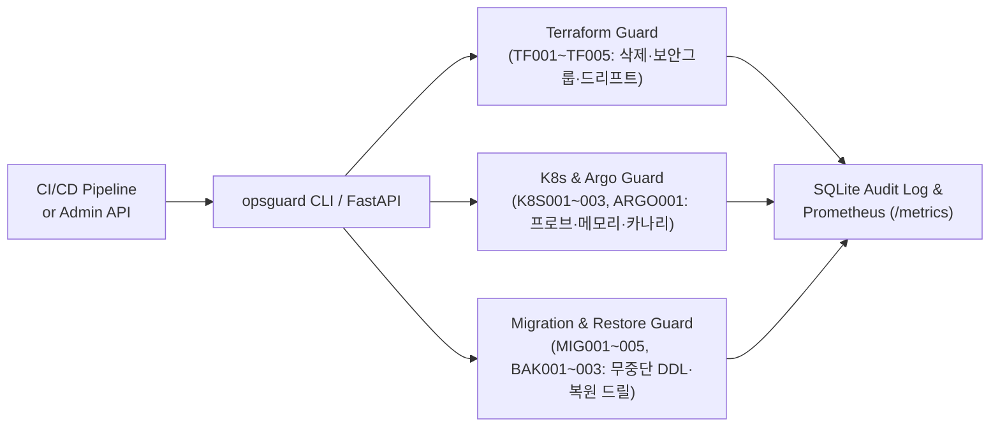

<p align="center">
  <h1 align="center">opsguard</h1>
  <p align="center"><b>Terraform · Kubernetes · Argo Rollouts 정책 검증기와 PostgreSQL 무중단 DDL 린터 및 복원 드릴 엔진</b></p>
  <p align="center">
    Python 3.11+ | FastAPI | Pydantic v2 | SQLAlchemy 2.0 | aiosqlite | PyYAML | prometheus-client | typer
  </p>
</p>

---

배포 파이프라인(CI/CD) 직전 단계에서 Terraform Plan의 파괴적 변경과 런타임 드리프트, Kubernetes 및 Argo Rollouts 매니페스트 오설정, 운영 DB 테이블 잠금을 유발하는 마이그레이션 DDL, 손상된 백업 덤프를 사전에 차단하는 검증 엔진입니다. Typer CLI(`opsguard`)로 CI 작업에서 바로 실행하거나 FastAPI 서버(`opsguard serve`)로 띄워 백오피스 API와 연동할 수 있습니다.

## 아키텍처 흐름도



## 왜 만들었나

커머스 서비스(`node-order`)를 무중단 배포하고 선언형 인프라를 운영할 때 네 가지 사고가 자주 발생합니다.

1. **Terraform Plan의 상태 저장소 삭제와 수동 콘솔 변경(Drift)**: 인프라 변경 중 실수로 운영 RDS나 S3 버킷 교체(`delete`)가 Plan에 포함되거나, 보안 그룹에서 DB(`5432`)·Redis(`6379`)·SSH(`22`) 포트가 `0.0.0.0/0`으로 열리는 사고가 생깁니다. 또한 장애 대응 중 클라우드 콘솔에서 수동으로 바꾼 설정이 코드와 어긋난 채 방치됩니다.
2. **Kubernetes 및 Argo Rollouts 매니페스트 누락**: `:latest` 이미지 태그, 컨테이너 메모리 `requests`/`limits`, `readinessProbe`/`livenessProbe`가 빠진 채 배포되거나, Argo Rollouts 카나리 단계에서 `analysis` 검증 없이 가중치만 올라가는 설정 오류가 발생합니다.
3. **무중단 배포 중 구버전 서버를 멈추게 하는 DB 마이그레이션 DDL**: 블루/그린이나 카나리 전환 중에 `DROP COLUMN`, `RENAME COLUMN`, `ALTER COLUMN TYPE`, 기본값 없는 `ADD COLUMN ... NOT NULL`, `CONCURRENTLY`가 빠진 `CREATE INDEX`를 실행하면 구버전 컨테이너 쿼리가 즉시 깨지거나 테이블 전체에 배타적 잠금이 걸려 결제가 멈춥니다.
4. **검증되지 않은 백업 덤프 파일**: 매일 새벽 DB 백업 파일이 만들어져도 실제로 복원이 되는지, 필수 테이블 행 수나 결제 금액 검증 규칙이 깨지지 않았는지 확인하지 않으면 장애 시점에 백업을 쓸 수 없습니다.

`opsguard`는 이 네 가지 배포 전 검증을 하나의 규칙 엔진과 감사 로그(`audit_records`)로 묶어 배포 파이프라인 초입에서 실행합니다.

## 구조와 설계 판단

```text
opsguard/
├── models.py            Pydantic v2 정책 리포트 스키마 및 SQLAlchemy 2.0 감사 로그(AuditRecord) 모델
├── terraform_guard.py   Terraform Plan 파괴적 변경(TF001~004) 및 런타임 스냅샷 드리프트(TF005) 검증기
├── k8s_guard.py         Kubernetes 워크로드(K8S001~003) 및 Argo Rollouts 카나리(ARGO001) 매니페스트 검증기
├── migration_guard.py   PostgreSQL Expand-Contract DDL 린터(MIG001~005) 및 인메모리 복원 드릴(BAK001~003)
├── api.py               FastAPI 검증 엔드포인트, aiosqlite 감사 기록, Prometheus 메트릭 노출
└── cli.py               Typer 기반 CLI (terraform, k8s, migration, restore, serve)
tests/
└── test_opsguard.py     16개 정책 규칙, 인메모리 복원 드릴, FastAPI 비동기 감사 기록 및 CLI 통합 검증
```

- **Terraform Plan JSON과 실제 런타임 스냅샷을 함께 대조합니다.** `resource_changes`에서 상태 저장 리소스(`aws_db_instance`, `aws_s3_bucket`, `aws_ebs_volume`)의 삭제·교체(`TF001`), 민감 포트(`22`, `5432`, `6379`) 전체 개방(`TF002`), 스토리지 미암호화 및 백업 보존 누락(`TF003`), 허용 목록 밖의 고비용 인스턴스(`TF004`)를 차단하고, 선언한 상태와 런타임 스냅샷을 비교해 속성 변경·누락·미관리 리소스(`TF005`)를 찾아냅니다.
- **Kubernetes 워크로드와 Argo Rollouts 카나리 배포 규칙을 YAML 파싱 단계에서 검사합니다.** 컨테이너 이미지 태그 누락이나 `:latest` 사용(`K8S001`), 메모리 `requests`/`limits` 누락(`K8S002`), `readinessProbe`/`livenessProbe` 누락(`K8S003`)을 잡으며, Argo Rollouts 리소스는 카나리 가중치(`setWeight`)가 단조 증가하는지와 승격 사이에 `analysis` 단계가 들어 있는지(`ARGO001`) 확인합니다.
- **무중단 배포를 깨뜨리는 DDL을 Expand 단계와 Contract 단계로 나누어 검사합니다.** 주석을 제거한 SQL 문장을 분석해 구버전 컨테이너가 함께 떠 있는 Expand 단계(`allow_contract=False`)에서는 `DROP COLUMN`/`DROP TABLE`(`MIG001`)을 차단하고, 모든 구버전 컨테이너가 내려간 Contract 단계(`--allow-contract`)에서만 허용합니다. 즉시 테이블을 잠그거나 호환성을 깨는 `RENAME`(`MIG002`), `ALTER COLUMN TYPE`(`MIG003`), `DEFAULT` 없는 `ADD COLUMN ... NOT NULL`(`MIG004`), `CONCURRENTLY` 없는 인덱스 생성·삭제(`MIG005`)는 항상 차단하고 우회 절차를 안내합니다.
- **백업 덤프는 SHA-256 해시 대조 뒤 인메모리 SQLite에 실제로 적재해 복원 드릴을 수행합니다.** 파일 체크섬 일치(`BAK001`)만 보는 데 그치지 않고, 격리된 인메모리 DB에 덤프 SQL을 직접 실행해 필수 테이블 존재 여부와 행 수(`>= 1`, `BAK002`), 주문·결제 금액 컬럼(`amount`, `total`, `price`, `payment_amount`)의 음수 데이터 유입 여부(`BAK003`)까지 확인합니다.
- **모든 API 검증 결과는 `aiosqlite`를 거쳐 `audit_records` 테이블에 남기고**, 검사 횟수(`opsguard_checks_total`)와 규칙별 위반 건수(`opsguard_violations_total`)를 Prometheus `/metrics`로 노출합니다.

## 정책 규칙 일람

| 규칙 ID | 심각도 | 영역 | 차단 조건 |
|---|---|---|---|
| `TF001` | ERROR | Terraform | `aws_db_instance`, `aws_s3_bucket`, `aws_ebs_volume` 삭제 또는 교체(`actions`에 `delete` 포함) |
| `TF002` | ERROR | Terraform | `aws_security_group` 인바운드에서 포트 `22`, `5432`, `6379`에 `0.0.0.0/0` 또는 `::/0` 허용 |
| `TF003` | ERROR | Terraform | `aws_db_instance`의 `storage_encrypted` 비활성화 또는 `backup_retention_period < 1` |
| `TF004` | ERROR | Terraform | 허용 목록 외의 고비용 컴퓨트·DB 인스턴스 타입 지정 |
| `TF005` | ERROR | Terraform | 선언 코드와 런타임 스냅샷 간 속성 불일치, 리소스 누락, 미관리(Shadow) 리소스 발견 |
| `K8S001` | ERROR | Kubernetes | 컨테이너 이미지 태그 생략 또는 `:latest` 지정 |
| `K8S002` | ERROR | Kubernetes | `resources.limits.memory` 또는 `resources.requests.memory` 설정 누락 |
| `K8S003` | ERROR | Kubernetes | `readinessProbe` 또는 `livenessProbe` 설정 누락 |
| `ARGO001` | ERROR | Argo Rollouts | `spec.strategy.canary.steps` 가중치 역전 또는 `analysis` 단계 누락 |
| `MIG001` | ERROR | Migration | Expand 단계에서 `DROP COLUMN`, `DROP TABLE` 실행 (`--allow-contract` 지정 시 허용) |
| `MIG002` | ERROR | Migration | 실행 중인 구버전 쿼리를 깨뜨리는 `RENAME COLUMN`, `RENAME TO` 실행 |
| `MIG003` | ERROR | Migration | 배타적 테이블 잠금과 전체 재작성을 유발하는 `ALTER COLUMN TYPE` 실행 |
| `MIG004` | ERROR | Migration | 테이블 잠금을 유발하는 `DEFAULT` 없는 `ADD COLUMN ... NOT NULL` 실행 |
| `MIG005` | ERROR | Migration | 쓰기 잠금을 유발하는 `CONCURRENTLY` 없는 인덱스 생성 및 삭제 |
| `BAK001` | ERROR | Backup Drill | 백업 덤프 파일의 SHA-256 해시 불일치 |
| `BAK002` | ERROR | Backup Drill | 복원 실행 실패, 필수 테이블 누락 또는 데이터 행 수 0건 |
| `BAK003` | ERROR | Backup Drill | 주문·결제 금액 컬럼에 음수 값 존재 또는 합계 음수 |

## 사용법

### 1. CLI 명령어 (`opsguard`)

```bash
# 1. Terraform Plan JSON 검사
opsguard terraform plan.json

# 2. Terraform 런타임 드리프트 검사
opsguard terraform desired.json --actual actual.json

# 3. Kubernetes / Argo Rollouts 매니페스트 검사
opsguard k8s deployment.yaml

# 4. SQL 무중단 마이그레이션 린트 (Expand 단계)
opsguard migration migration.sql

# 5. SQL 무중단 마이그레이션 린트 (Contract 단계: 구버전 컨테이너 종료 후 DROP 허용)
opsguard migration migration.sql --allow-contract

# 6. 백업 덤프 복원 드릴 검증
opsguard restore dump.sql --sha256 <expected-hash> --table users --table orders

# 7. FastAPI 검증 서버 기동
opsguard serve --host 0.0.0.0 --port 8004
```

### 2. HTTP API 엔드포인트

- `POST /v1/verify/terraform`: Terraform Plan 또는 런타임 드리프트 검증
- `POST /v1/verify/k8s`: Kubernetes 및 Argo Rollouts YAML 검증
- `POST /v1/verify/migration`: PostgreSQL Expand-Contract 무중단 DDL 검증
- `POST /v1/verify/restore`: 백업 덤프 SHA-256 및 인메모리 복원 드릴 검증
- `GET /healthz`: 서버 상태 확인
- `GET /metrics`: Prometheus 메트릭 노출 (`opsguard_checks_total`, `opsguard_violations_total`)

## 테스트 실행

```bash
# 전체 점검 (린트, 타입 검사, 단위·통합 테스트)
make check

# 개별 실행
ruff check opsguard tests
mypy opsguard tests
pytest -v tests/
```

## 범위와 한계

- SQL 마이그레이션 린터는 정규화한 DDL 구문 패턴을 정적으로 검사하므로, PL/pgSQL 함수 본문이나 동적 문자열(`EXECUTE`) 안에 숨겨진 DDL은 별도 실행 계획 검토가 필요합니다.
- 백업 복원 드릴(`verify_backup_restore_drill`)은 외부 DB 컨테이너 없이 빠르게 검증하기 위해 표준 SQL 덤프를 인메모리 SQLite에서 실행합니다. PostgreSQL 고유 확장 문법(`COPY ... FROM stdin`, 커스텀 타입)이 포함된 바이너리 덤프는 임시 PostgreSQL 인스턴스를 대상으로 검증해야 합니다.
