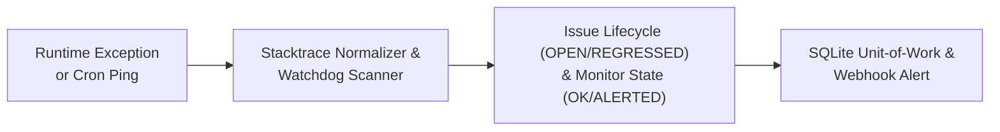

<p align="center">
  <h1 align="center">pulsebox</h1>
  <p align="center"><b>에러 스택트레이스 정규화 지문 그룹핑 및 크론 데드맨 스위치 모니터링 서버</b></p>
  <p align="center">
    Python 3.11+ | FastAPI | Pydantic v2 | SQLAlchemy 2.0 | SQLite | Prometheus
  </p>
</p>

---

단일 서버나 소규모 팀 환경에서 대규모 모니터링 인프라 없이 독립 프로세스로 띄워 쓰는 경량 에러 지문(Fingerprint) 수집기 겸 크론 데드맨 스위치(Dead Man's Switch) 모니터링 서버입니다.

런타임 예외 스택트레이스의 동적 주소나 줄 번호를 정규화해 고유 지문으로 묶고, 정기 배치 작업의 체크인 신호 지연을 감지해 웹훅으로 경보를 발송합니다.

## 아키텍처 흐름도



## 핵심 구조

### 1. 스택트레이스 정규화와 SHA-256 지문 계산
예외가 발생할 때마다 달라지는 힙 메모리 주소(`0x7ffee1`), 소스 코드 수정으로 밀려난 줄 번호(`line 42`), UUID, ISO 타임스탬프를 `<addr>`, `line <n>`, `<uuid>`, `<timestamp>` 토큰으로 치환합니다. 정규화된 프레임 구조와 서비스 이름, 예외 타입을 조합해 64자리 SHA-256 해시를 산출하므로 원인이 같은 예외는 항상 동일한 이슈 그룹으로 수렴합니다.

### 2. 이슈 수명 주기와 알림 쿨다운
- `OPEN`: 처음 관측된 지문으로 이슈 그룹을 생성하고 즉시 웹훅 알림을 발생시킵니다.
- 중복 유입: 이미 열려 있는 이슈에 같은 지문의 예외가 들어오면 발생 횟수(`occurrence_count`)와 마지막 관측 시각만 갱신합니다. 설정된 쿨다운 시간(기본 300초)이 지나기 전에는 알림 발송을 생략해 알림 폭주를 억제합니다.
- `RESOLVED` 및 `REGRESSED`: 운영자가 원인을 해결하고 `RESOLVED`로 처리한 이슈에 같은 지문이 다시 유입되면 상태를 `REGRESSED`로 전이하고 쿨다운과 무관하게 즉시 재알림을 발송합니다.

### 3. 크론 데드맨 스위치 원장
백업, 데이터 동기화, 정산 배치 작업이 주기적으로 `/v1/monitors/{slug}/ping` 엔드포인트를 호출합니다. 마지막 체크인 시각으로부터 `interval_seconds + grace_seconds`가 지나도 신호가 오지 않으면 워치독이 모니터 상태를 `ALERTED`로 전이하고 누적 미수신 횟수를 올린 뒤 웹훅을 쏩니다. 작업이 다시 신호를 보내면 즉시 `OK`로 복구됩니다.

### 4. SQLAlchemy 2.0과 asyncio.to_thread 격리
FastAPI의 비동기 이벤트 루프가 동기 DB 드라이버 I/O에 블로킹되지 않도록 모든 트랜잭션 단위 작업을 `asyncio.to_thread`로 분리했습니다. SQLite 환경에서는 스레드 간 연결 공유로 인한 오류를 막기 위해 내부 스레딩 락을 함께 적용했습니다.

## 요구 사항

- Python 3.11 이상
- FastAPI, SQLAlchemy 2.0, Pydantic v2, HTTPX

## 설치 및 실행

### 패키지 설치
```bash
pip install -e .
```

### 서버 구동
```bash
# 기본 SQLite 파일(pulsebox.db)로 서버 시작
pulsebox server --host 127.0.0.1 --port 8000 --db sqlite:///pulsebox.db

# 또는 uvicorn 직접 실행
uvicorn pulsebox.app:create_app --factory --host 127.0.0.1 --port 8000
```

### CLI 명령어
```bash
# 연체된 크론 모니터 즉시 스캔
pulsebox scan --db sqlite:///pulsebox.db

# 크론 체크인 핑 전송
pulsebox ping daily-backup --db sqlite:///pulsebox.db

# 등록된 에러 이슈 목록 조회
pulsebox issues --db sqlite:///pulsebox.db
```

## API 명세

| 메서드 | 경로 | 설명 |
| --- | --- | --- |
| `POST` | `/v1/events` | 에러 이벤트 수집 및 지문 그룹핑 (`{"issue": ..., "alerted": bool}`) |
| `GET` | `/v1/issues` | 이슈 그룹 목록 조회 (서비스 및 상태 필터 지원) |
| `POST` | `/v1/issues/{fingerprint}/resolve` | 이슈 상태를 `RESOLVED`로 변경 |
| `POST` | `/v1/monitors` | 크론 데드맨 스위치 모니터 등록 |
| `GET` | `/v1/monitors` | 등록된 크론 모니터 목록 조회 |
| `POST` | `/v1/monitors/{slug}/ping` | 크론 작업 체크인 핑 기록 |
| `POST` | `/v1/watchdog/scan` | 미수신 크론 모니터 수동 평가 및 웹훅 발송 |
| `GET` | `/healthz` | 헬스 체크 (`{"status": "ok"}`) |
| `GET` | `/metrics` | 프로메테우스 텍스트 포맷 메트릭 출력 |

## 테스트 실행

```bash
# 전체 테스트 실행
pytest -v

# 린트 및 타입 검사
ruff check pulsebox tests
mypy pulsebox tests
```
