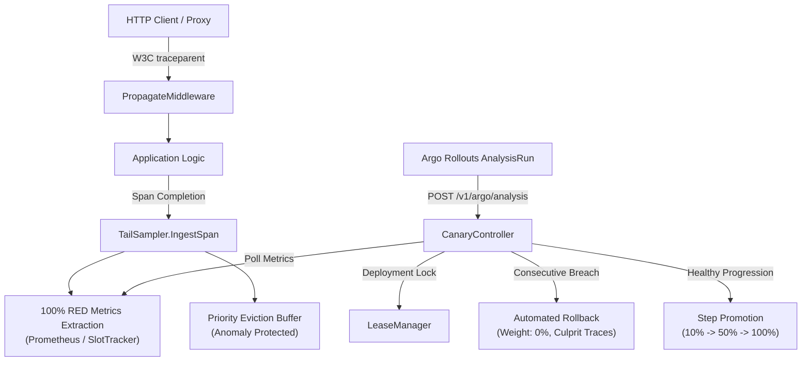

# rolltrace

rolltrace는 카나리 배포 환경에서 분산 트레이스와 RED 메트릭을 실시간 수집하고, SLO 기반으로 롤백 여부를 판정하는 관측성 데몬입니다. W3C Trace Context 표준을 지원하며, Argo Rollouts 웹훅 및 OTLP 스팬 수집 파이프라인과 직접 연동됩니다.

## Architecture



## Core Design Decisions

### 1. Tail-based Sampling vs Head-based Sampling
요청 진입 시점에 무작위로 추출하는 Head-based 방식은 장애 발생 시점의 에러 트레이스를 놓칠 위험이 큽니다. rolltrace는 요청이 완료된 시점에 스팬 속성을 평가하는 Tail-based 방식을 사용합니다.
- 다음 조건 중 하나라도 만족하는 트레이스는 `DecisionKeepAnomaly`로 분류되어 100% 버퍼에 남습니다.
  - HTTP 상태 코드가 `ErrorStatusThreshold`(기본 500) 이상인 경우
  - 명시적 에러 플래그(`Error: true`)가 설정된 경우
  - 실행 지연이 `LatencyThresholdMs`(기본 500ms) 이상인 경우
  - 폴백 핸들러(`FallbackUsed: true`)가 동작한 경우
- 이상이 없는 정상 트레이스는 `xxhash` 해시 모듈로 연산을 적용해 `BaseSampleRate`(기본 5%) 비율로만 보존하여 메모리를 절약합니다.

### 2. RED SpanMetrics 선추출
샘플링 판정 결과와 무관하게 모든 스팬이 도착하는 즉시 Prometheus 카운터와 지연 시간 히스토그램을 먼저 갱신합니다. 트레이스 보존율과 상관없이 실제 유입된 모든 트래픽의 에러율과 P99 지연시간을 수치 그대로 측정하므로 왜곡 없는 SLO 평가가 가능합니다.

### 3. 최소 표본수(Minimum Sample Count) 게이트
카나리 배포 직후 트래픽 유입량이 적은 상태(예: 3건)에서 단 1건의 네트워크 순시 에러가 발생하면 표본 에러율이 33%로 치솟아 조기 롤백이 발생하는 거짓 양성(False Positive) 문제가 생깁니다.
rolltrace는 `MinSampleCount`(기본 20건) 미만의 표본에서는 에러율이 임계값을 넘더라도 `ActionHold`(`ReasonInsufficientSamples`) 상태를 유지하고 가중치를 유지하여 불필요한 배포 취소를 방지합니다.

### 4. Priority Eviction 링버퍼
인메모리 버퍼가 `MaxBufferedTraces`(기본 2048) 한계에 도달하면 정상 트레이스(`hasAnomaly == false`) 중 가장 오래된 항목을 먼저 축출합니다. 이상 트레이스(`hasAnomaly == true`)는 버퍼 전체가 이상 트레이스로 가득 차지 않는 한 계속 보존되어 디버깅에 필요한 원인 조사가 가능합니다.

### 5. 원자적 배포 리스 (Deployment Lease)
동일 서비스에 대해 복수의 배포 워커가 동시에 카나리를 진행하면 트래픽 가중치 충돌이나 스플릿 브레인(Split-Brain)이 발생할 수 있습니다. rolltrace는 `LeaseManager`를 두고 배포 시작 시 원자적 리스를 발급받도록 제한합니다. 기존 보유자가 아니면 `ErrLeaseHeld`로 차단되며, 롤백이나 배포 완료 시 자동으로 리스를 반납합니다.

## HTTP API Reference

| Endpoint | Method | Description |
| :--- | :--- | :--- |
| `/v1/traces` | POST | OTLP JSON 또는 자체 JSON 형식의 스팬 데이터를 수집합니다. |
| `/v1/traces/{traceID}` | GET | 보존 판정된 트레이스의 전체 스팬 목록을 반환합니다. |
| `/v1/rollouts/start` | POST | 서비스의 카나리 배포를 시작하고 리스를 선점합니다. |
| `/v1/rollouts/evaluate` | POST | 현재 카나리 슬롯 메트릭을 SLO와 비교 평가합니다. |
| `/v1/argo/analysis` | POST | Argo Rollouts AnalysisRun 웹훅과 호환되는 결과를 반환합니다. |
| `/healthz` | GET | 데몬 생존 상태와 가동 시간을 반환합니다. |
| `/metrics` | GET | Prometheus 표준 메트릭을 노출합니다. |

### API 사용 예시

#### 1. 스팬 수집 (`POST /v1/traces`)
```bash
curl -X POST http://localhost:8080/v1/traces \
  -H "Content-Type: application/json" \
  -d '{
    "trace_id": "4bf92f3577b34da6a3ce929d0e0e4736",
    "span_id": "00f067aa0ba902b7",
    "service": "checkout",
    "operation": "POST /pay",
    "status_code": 500,
    "duration_ms": 620,
    "slot": "canary"
  }'
```

#### 2. 카나리 롤아웃 시작 (`POST /v1/rollouts/start`)
```bash
curl -X POST http://localhost:8080/v1/rollouts/start \
  -H "Content-Type: application/json" \
  -d '{
    "service": "checkout",
    "version": "v2.1.0",
    "holder_id": "argo-rollout-checkout-worker"
  }'
```

#### 3. Argo Rollouts Analysis 평가 (`POST /v1/argo/analysis`)
```bash
curl -X POST "http://localhost:8080/v1/argo/analysis?service=checkout"
```

응답 예시 (연속 2회 SLO 위반 시 롤백 트리거):
```json
{
  "phase": "Failed",
  "message": "SLO breach threshold reached; triggered automated rollback",
  "culprit_trace_ids": [
    "4bf92f3577b34da6a3ce929d0e0e4736"
  ],
  "error_rate": 0.085,
  "p99_latency_ms": 940.0
}
```

## Argo Rollouts AnalysisTemplate Example

```yaml
apiVersion: argoproj.io/v1alpha1
kind: AnalysisTemplate
metadata:
  name: rolltrace-slo-gate
spec:
  metrics:
  - name: canary-health
    interval: 10s
    successCondition: result.phase == "Successful" || result.phase == "Running"
    failureLimit: 0
    provider:
      web:
        url: "http://rolltrace.observability.svc:8080/v1/argo/analysis?service=checkout"
        jsonPath: "{$.phase}"
```

## CLI Flags

| Flag | Default | Description |
| :--- | :--- | :--- |
| `-http-addr` | `:8080` | HTTP 수신 주소 및 포트 |
| `-service` | `rolltrace` | 기본 서비스 식별자 |
| `-latency-threshold` | `500` | 이상 트레이스 판정 지연시간 임계값 (ms) |
| `-error-threshold` | `500` | 이상 트레이스 판정 HTTP 상태 코드 |
| `-base-sample-rate` | `0.05` | 정상 트레이스 대상 결정론적 샘플링 비율 (0.0 ~ 1.0) |
| `-max-buffered-traces` | `2048` | 메모리에 보존할 최대 트레이스 수 |
| `-min-sample-count` | `20` | SLO 평가 전 요구되는 최소 요청 수 |
| `-consecutive-breaches` | `2` | 자동 롤백을 발동하는 연속 위반 횟수 |

## Build & Test

```bash
# 기본 빌드
make build

# 단위 테스트
make test

# 데이터 경합 검증
make race
```
