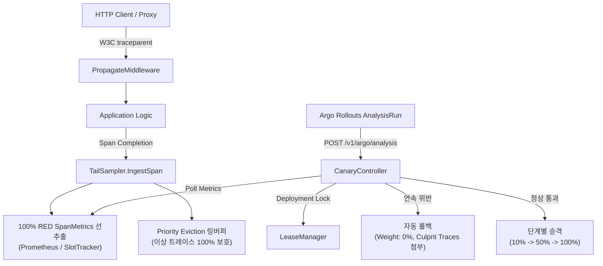

<p align="center">
  <h1 align="center">rolltrace</h1>
  <p align="center"><b>W3C Trace Context 전파 · OTLP Tail-based 샘플러 및 카나리 SLO 자동 롤백 데몬</b></p>
  <p align="center">
    Go 1.24+ | net/http | xxhash/v2 | tidwall/gjson | client_golang | W3C TraceContext | Argo Rollouts
  </p>
</p>

---

카나리 배포 환경에서 분산 트레이스와 RED(요청 수, 에러율, 지연 시간) 지표를 실시간으로 수집하고, SLO 위반 여부를 판정해 점진적 가중치 승격(`10% -> 50% -> 100%`)이나 즉시 롤백(`0%`)을 수행하는 관측성 데몬입니다. Go 표준 `net/http` 미들웨어로 애플리케이션에 직접 넣거나, OTLP JSON 및 Argo Rollouts AnalysisRun 웹훅을 처리하는 독립 데몬(`cmd/rolltrace`)으로 실행할 수 있습니다.

## 아키텍처 흐름도



## 왜 만들었나

무중단 카나리 배포와 분산 추적을 운영할 때 세 가지 문제가 반복해서 발생합니다.

1. **Head-based 샘플링의 에러 트레이스 유실과 메트릭 왜곡**: 요청이 들어오는 시점에 5% 확률로 샘플링 여부를 정해 버리면, 정작 장애가 났을 때 원인이 담긴 `5xx` 에러나 타임아웃 트레이스의 95%가 버려집니다. 반대로 샘플링된 스팬으로만 에러율과 지연을 계산하면 모수가 줄어들어 SLO 수치가 왜곡됩니다.
2. **저트래픽 구간의 조기 롤백 오탐(False Positive)**: 카나리 슬롯을 막 열어 요청이 3건밖에 들어오지 않은 상태에서 일시적 네트워크 순단으로 1건이 실패하면, 순간 에러율이 33.3%로 계산되어 정상 배포인데도 롤백이 발동됩니다.
3. **동시 배포 워커 간 가중치 충돌**: 같은 서비스에 두 개 이상의 배포 파이프라인이 동시에 돌면 카나리 가중치와 슬롯 상태가 뒤섞여 장애 원인을 구분할 수 없게 됩니다.

`rolltrace`는 전수 SpanMetrics 선추출, 이상 트레이스 우선 보존 Tail-based 샘플러, 최소 표본수 게이트, 원자적 배포 리스를 결합해 이 문제들을 해결합니다.

## 구조와 주요 설계 판단

```text
pkg/rolltrace/
├── config.go         샘플러, 카나리 SLO, 배포 리스 설정 및 유효성 검사
├── tracecontext.go   W3C traceparent 파서/생성기 및 HTTP 컨텍스트 전파 미들웨어
├── tailsampler.go    100% RED SpanMetrics 선추출, xxhash Tail-based 샘플러, Priority Eviction 링버퍼
├── lease.go          서비스별 원자적 배포 리스(TTL, 멱등 갱신, 소유자 검증)
├── canary.go         최소 표본수 게이트 기반 SLO 평가기 및 단계별 승격·자동 롤백 상태 머신
├── server.go         OTLP/JSON 수집, 롤아웃 제어, Argo Rollouts 웹훅, Prometheus 핸들러
└── server_test.go    단위·통합 및 120 고루틴 동시성 경합 검증 (go test -race)
cmd/rolltrace/
└── main.go           signal.NotifyContext 기반 독립 실행 데몬 (/healthz, /metrics)
```

- **샘플링 판정 전에 모든 스팬에서 RED SpanMetrics를 100% 먼저 추출합니다.** 스팬이 수집기로 들어오는 즉시 슬롯(`stable`, `canary`)별 요청 카운터, 에러 카운터, 지연 시간 히스토그램을 먼저 갱신합니다. 트레이스를 5%만 메모리에 남기더라도 SLO 판정에 쓰는 에러율과 P99 지연 시간은 전체 트래픽 모수를 그대로 반영합니다.
- **요청이 끝난 뒤 결과를 보고 판단하는 Tail-based 샘플링으로 장애 단서를 100% 남깁니다.** HTTP 상태 코드가 임계값(`ErrorStatusThreshold`, 기본 `500`) 이상이거나, 에러 플래그(`Error: true`), 지연 초과(`LatencyThresholdMs`, 기본 `500ms`), 서킷 브레이커 폴백(`FallbackUsed: true`) 중 하나라도 해당하면 `DecisionKeepAnomaly`로 분류해 모두 보존합니다. 정상 트레이스만 `xxhash/v2` 해시 연산으로 `BaseSampleRate`(기본 5%) 비율만큼 남깁니다.
- **인메모리 버퍼가 가득 차면 정상 트레이스부터 먼저 비우는 Priority Eviction을 적용했습니다.** 보존 트레이스 수가 `MaxBufferedTraces`(기본 2,048개) 상한에 도달하면 가장 오래된 정상 트레이스를 먼저 축출하고, 이상 트레이스는 버퍼 전체가 이상 트레이스로만 채워지지 않는 한 끝까지 보호합니다.
- **최소 표본수(`MinSampleCount`) 게이트와 연속 위반 횟수로 카나리 오탐 롤백을 막았습니다.** 카나리 슬롯의 누적 요청 수가 최소 기준(기본 20건)에 도달하기 전까지는 에러율이 높아도 `ActionHold`(`ReasonInsufficientSamples`)로 대기합니다. 표본이 충분히 모인 뒤 연속 `ConsecutiveBreaches`(기본 2회) 이상 SLO를 어겼을 때만 가중치를 `0%`로 되돌리고, 원인이 된 이상 트레이스 ID 목록(`culprit_trace_ids`)을 응답에 함께 담아 반환합니다.
- **서비스별 원자적 배포 리스(`LeaseManager`)로 동시 배포 충돌을 차단합니다.** 롤아웃 시작 시 리스를 선점하게 해 다른 배포 워커가 동시에 끼어들면 `ErrLeaseHeld`(`409 Conflict`)로 거절하고, 배포가 `100%` 승격 완료되거나 자동 롤백되면 리스를 즉시 반납합니다.

## 사용법

### 1. 독립 데몬 실행 (`cmd/rolltrace`)

```sh
# 빌드
make build

# 실행
./bin/rolltrace \
  -http-addr :8083 \
  -service order-api \
  -latency-threshold 500 \
  -error-threshold 500 \
  -base-sample-rate 0.05 \
  -max-buffered-traces 2048 \
  -min-sample-count 20 \
  -consecutive-breaches 2
```

### 2. 주요 HTTP 엔드포인트

| Endpoint | Method | 설명 |
| :--- | :--- | :--- |
| `/v1/traces` | `POST` | OTLP JSON(`resourceSpans`) 또는 단일/배열 스팬 JSON 수집 |
| `/v1/traces/{traceID}` | `GET` | 보존된 트레이스의 전체 스팬 목록 조회 |
| `/v1/rollouts/start` | `POST` | 서비스 카나리 롤아웃 시작 및 배포 리스 선점 |
| `/v1/rollouts/evaluate` | `POST` | 현재 카나리 슬롯 메트릭을 SLO 기준과 비교해 승격·유지·롤백 판정 |
| `/v1/argo/analysis` | `POST` | Argo Rollouts `AnalysisRun` 웹훅 호환 결과(`Successful`, `Running`, `Failed`) 반환 |
| `/healthz` | `GET` | 데몬 생존 상태 및 가동 시간 반환 |
| `/metrics` | `GET` | Prometheus 표준 메트릭 노출 |

#### 스팬 수집 (`POST /v1/traces`)
```bash
curl -X POST http://localhost:8083/v1/traces \
  -H "Content-Type: application/json" \
  -d '{
    "trace_id": "4bf92f3577b34da6a3ce929d0e0e4736",
    "span_id": "00f067aa0ba902b7",
    "service": "checkout",
    "operation": "POST /pay",
    "status_code": 500,
    "duration_ms": 620,
    "slot": "canary"
  }'
```

#### 카나리 롤아웃 시작 및 Argo Rollouts 분석 (`POST /v1/argo/analysis`)
```bash
curl -X POST http://localhost:8083/v1/rollouts/start \
  -H "Content-Type: application/json" \
  -d '{"service": "checkout", "version": "v2.1.0", "holder_id": "argo-rollout-worker"}'

curl -X POST "http://localhost:8083/v1/argo/analysis?service=checkout"
```

연속 2회 SLO 위반 시 응답 예시:
```json
{
  "phase": "Failed",
  "message": "SLO breach threshold reached; triggered automated rollback",
  "culprit_trace_ids": [
    "4bf92f3577b34da6a3ce929d0e0e4736"
  ],
  "error_rate": 0.085,
  "p99_latency_ms": 940.0
}
```

### 3. Argo Rollouts `AnalysisTemplate` 연동 예시

```yaml
apiVersion: argoproj.io/v1alpha1
kind: AnalysisTemplate
metadata:
  name: rolltrace-slo-gate
spec:
  metrics:
  - name: canary-health
    interval: 10s
    successCondition: result.phase == "Successful" || result.phase == "Running"
    failureLimit: 0
    provider:
      web:
        url: "http://rolltrace.observability.svc:8083/v1/argo/analysis?service=checkout"
        jsonPath: "{$.phase}"
```

### 4. CLI 플래그

| Flag | Default | 설명 |
| :--- | :--- | :--- |
| `-http-addr` (`-listen`) | `:8080` | HTTP 서버 수신 주소 및 포트 |
| `-service` | `rolltrace` | 기본 서비스 식별자 |
| `-latency-threshold` | `500` | 이상 트레이스 판정 지연 시간 임계값 (ms) |
| `-error-threshold` | `500` | 이상 트레이스 판정 HTTP 상태 코드 기준 |
| `-base-sample-rate` | `0.05` | 정상 트레이스 해시 샘플링 비율 (`0.0` ~ `1.0`) |
| `-max-buffered-traces` | `2048` | 메모리에 보존할 최대 트레이스 수 |
| `-min-sample-count` | `20` | SLO 평가 전 요구되는 최소 요청 표본 수 |
| `-consecutive-breaches` | `2` | 자동 롤백을 발동하는 연속 SLO 위반 횟수 |

## 테스트

외부 인프라 의존성 없이 로컬에서 단위·통합 테스트와 데이터 경합 검사가 모두 통과합니다.

```sh
make test
make race
```

- `TestTraceContext_ParseAndFormat`: W3C `traceparent` 헤더 파싱, 전파, 자식 스팬 생성 및 잘못된 형식 거부 검증
- `TestPropagateMiddleware`: HTTP 미들웨어의 `traceparent`·`X-Trace-ID` 응답 헤더 주입 및 스팬 자동 수집 검증
- `TestTailSampler_AnomalyRetention`: `5xx`·고지연·폴백 발생 트레이스 100% 보존 및 정상 트레이스 5% 해시 샘플링 비율 검증
- `TestTailSampler_PriorityEviction`: 버퍼 포화 시 정상 트레이스 우선 축출 및 이상 트레이스 보존 검증
- `TestLeaseManager_AcquireAndConflict`: 배포 리스 원자적 선점, 멱등 갱신, 타 워커 충돌(`ErrLeaseHeld`) 및 만료 후 회수 검증
- `TestCanaryController_SampleCountGate`: 최소 표본수(20건) 미달 시 고에러율 구간에서도 조기 롤백 없이 `ActionHold` 유지 검증
- `TestCanaryController_ConsecutiveBreachRollback`: 연속 2회 SLO 위반 시 가중치 `0%` 롤백, `CulpritTraceIDs` 첨부, 리스 자동 반납 검증
- `TestCanaryController_SuccessfulPromotion`: 정상 지표 구간에서 `10% -> 50% -> 100%` 점진적 승격 및 `RolloutStable` 완료 검증
- `TestServer_Endpoints`: `/v1/traces`, `/v1/rollouts/*`, `/v1/argo/analysis`, `/healthz`, `/metrics` HTTP 엔드포인트 통합 검증
- `TestConcurrent_RaceCondition`: 120개 고루틴이 동시에 스팬 수집·메트릭 조회·리스 경합을 수행할 때 데이터 경합(`-race`) 여부 검증

## 범위와 한계

- 트레이스 링버퍼와 배포 리스 상태는 단일 프로세스의 인메모리 뮤텍스로 관리합니다. 여러 수집기 인스턴스로 수평 확장할 때는 같은 `trace_id`가 같은 인스턴스로 모이도록 라우팅하거나 외부 공유 저장소를 붙여야 합니다.
- 스팬 수집 엔드포인트(`/v1/traces`)는 OTLP JSON(`resourceSpans`)과 단일·배열 JSON 페이로드를 처리하며, gRPC 기반 OTLP Protobuf 바이너리 스트림을 직접 받으려면 앞단에 OpenTelemetry Collector 변환을 두어야 합니다.
